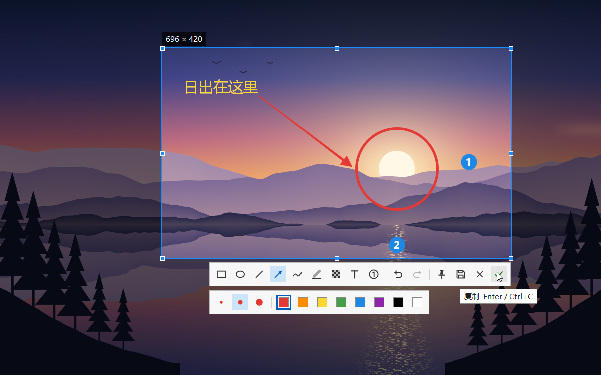

# sniplite

**极度轻量的截图贴图工具，核心用汇编开发**

  

[**下载**](#下载) · [默认快捷键](#默认快捷键) · [常见问题](#常见问题)

 
 

## 特色

- **快**：按F1截图 领先99%截图软件的截图速度
- **轻**：本体不到200KB，无需安装任何运行库，截图和绘图的核心代码用汇编编写
- **能贴图**：把截图钉在屏幕最上层，切到别的窗口也挡不住，对照着看很方便
- **够用**：功能全面，截图，贴图，箭头，文字，马赛克 样样都有
- **干净**：没有广告，开源，无日志，不收集数据

## 下载

到 [Releases](https://github.com/MrTangLuyao/sniplite/releases/latest) 下载最新版安装。

> [!TIP]
> 图标在任务栏右下角，没看到的话点一下那里的小箭头。想让它一直显示，在 Windows 设置里搜索“其他系统托盘图标”，把 sniplite 打开。

## 默认快捷键

| 按键 | 作用 |
| --- | --- |
| **F1** | 截图 |
| **F3** | 把复制的图片或文字贴到屏幕上 |
| **Shift+F3** | 隐藏 / 显示所有贴图 |
| **Enter** | 复制截图 |
| **Ctrl+S** | 保存截图 |
| **Ctrl+T** | 把截图贴到屏幕上 |
| **Esc** | 取消截图 |
| **滚轮** | 截图时换窗口范围，贴图时缩放 |
| **双击** | 关闭贴图 |

## 常见问题

**软件有多大？**

极其轻量，不到 1 MB。

**为什么这么快？**

截图、画面合成、绘制、截图界面和贴图这些要快的部分用 x86-64 汇编编写，其余部分用 C，整个程序不依赖 C 运行库。截图直接从显卡读取屏幕画面，交给系统在显卡上合成显示，比 Windows 常用的截屏方法快很多。

**占多少内存？**

平时大约 50 MB，主要是显卡驱动占的，刚截完图会短暂多占一些。想更省的话，可以在首选项的截屏页里选省内存，只占 2 MB 左右，代价是截图会慢一点。

**会在电脑上留下什么？**

不用管理员权限，不改注册表。改过设置后会多一个设置文件，删掉它就恢复默认。

**怎么更新？**

软件每天会到 GitHub 看一眼有没有新版本，有的话右下角会提示，点一下就能更新。只查版本号，不上传任何数据，不想要可以在首选项里关掉。

**怎么卸载？**

在开始菜单的 sniplite 文件夹里点“卸载 sniplite”，程序、设置和快捷方式都会删掉。

**能用命令行吗？**

能，运行 sniplite help 就能看到用法。

## 自己编译

装好 [w64devkit](https://github.com/skeeto/w64devkit)（或其他 MinGW-w64），把它的 `bin` 文件夹加进 PATH，然后运行 `build.bat`，程序会生成在 `build` 文件夹里。源码在 `src` 里：要快的部分是汇编文件（`.S`），由 gcc 调用 GNU 汇编器编译，其余是 C 文件（`.c`）。不链接 C 运行库，只用到 Windows 自带的系统库。

## 许可证

[MIT](LICENSE)
