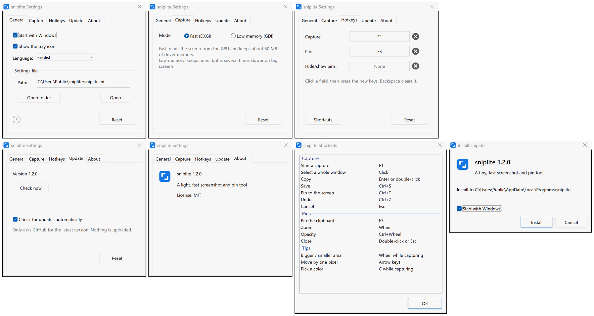

# sniplite

**A tiny, fast screenshot and pin tool, with its core written in assembly**

       

  

[**Download**](#download) | [Default shortcuts](#default-shortcuts) | [FAQ](#faq)

 
 

## Features

- **Fast**: press F1 and the screenshot is there, sooner than in 99% of screenshot tools
- **Light**: about 220 KB, nothing else to install; the capture and drawing core is written in assembly
- **Pins**: pin a screenshot on top of every other window, so it stays in view while you work
- **Complete**: screenshots, pins, arrows, text, mosaic: it is all there
- **Clean**: no ads, open source, no logs, no data collected
- **Multilingual**: 8 languages, following Windows unless you pick one

## Download

Get the latest installer from [Releases](https://github.com/MrTangLuyao/sniplite/releases/latest).

> [!TIP]
> The icon is at the right end of the taskbar; click the small arrow there if you do not see it. To keep it in view, search Windows Settings for "Other system tray icons" and turn sniplite on.

## Default shortcuts

| Key | What it does |
| --- | --- |
| **F1** | Capture |
| **F3** | Pin the copied image or text to the screen |
| **Shift+F3** | Hide / show all pins |
| **Enter** | Copy the capture |
| **Ctrl+S** | Save the capture |
| **Ctrl+T** | Pin the capture to the screen |
| **Esc** | Cancel the capture |
| **Wheel** | Capturing: pick a bigger or smaller window; on a pin: zoom |
| **Double-click** | Close a pin |

## FAQ

**How big is it?**

Tiny: under 1 MB.

**Why is it so fast?**

The parts that have to be fast (capture, composition, drawing, the capture overlay and pins) are written in x86-64 assembly and the rest in C, with no C runtime. A screenshot is read straight from the graphics card and handed to Windows to compose on the GPU, which is much faster than the usual ways of capturing the screen on Windows.

**How much memory does it use?**

About 50 MB most of the time, nearly all of it held by the graphics driver, and a little more right after a capture. To use less, choose Low memory on the Capture page of Settings: about 2 MB, with slower captures.

**What does it leave on my computer?**

It needs no administrator rights and does not touch the registry. Changing a setting creates one settings file; delete it to get the defaults back.

**How do I change the language?**

sniplite follows the language of Windows. To use another, open Settings from the tray icon and pick it under Language.

**How do I update?**

Once a day sniplite asks GitHub whether there is a newer version. If there is, a notification appears at the bottom right, and one click updates. Only the version number is checked and nothing is uploaded; you can turn this off in Settings.

**How do I uninstall it?**

Click "Uninstall sniplite" in the sniplite folder of the Start menu. The program, its settings and its shortcuts are removed.

**Is there a command line?**

Yes. Run `sniplite help` to see it.

## Settings

## Build it yourself

Install [w64devkit](https://github.com/skeeto/w64devkit) (or another MinGW-w64), add its `bin` folder to PATH and run `build.bat`; the programs appear in the `build` folder. The source is in `src`: the fast parts are assembly files (`.S`), assembled by gcc with the GNU assembler, the rest is C (`.c`). No C runtime is linked, only the system libraries that come with Windows.

## License

[MIT](LICENSE)
