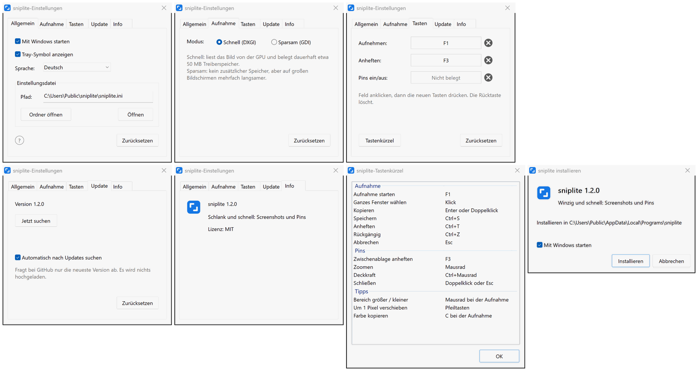

# sniplite

**Ein winziges, schnelles Werkzeug für Screenshots und Pins, im Kern in Assembler geschrieben**

       

  

[**Download**](#download) | [Standard-Tastenkürzel](#standard-tastenkürzel) | [Häufige Fragen](#häufige-fragen)

 
 
 

 

## Merkmale

- **Schnell**: F1 drücken, und der Screenshot ist da, schneller als bei 99 % der Screenshot-Programme
- **Schlank**: etwa 360 KB, nichts weiter zu installieren; der Kern für Aufnahme und Zeichnen ist in Assembler geschrieben
- **Pins**: einen Screenshot über allen Fenstern anheften, damit er beim Arbeiten im Blick bleibt
- **Komplett**: Screenshots, Pins, Pfeile, Text, Verpixeln, Spotlight, Lupe, alles dabei
- **Messen**: Ein Bildschirmlinieal misst Abstand, Größe und Winkel zwischen zwei Punkten; Umschalt rastet auf 0°/45°/90° ein, Alt misst von der Mitte aus, Enter kopiert den Messwert; das Randlineal zeigt dauerhaft Skalen am oberen und linken Bildschirmrand, ein dünnes Fadenkreuz folgt der Maus und zeigt beim Anhalten die Koordinaten samt Pixel-Lupe
- **Texterkennung**: liest den Text einer Aufnahme, auch Tabellen; ein optionales Modul, das vollständig auf dem eigenen Computer läuft
- **Scrollaufnahmen**: Seite scrollen, sie wird laufend zusammengesetzt
- **Aufnahme**: Bereich auswählen und Ctrl+R drücken, um ihn mit dem Mauszeiger als MP4 (H.264, 30 fps) aufzunehmen; die Leiste kann pausieren; das Infobereichsmenü oder Ctrl+Alt+R startet die Aufnahme direkt nach der Bereichsauswahl
- **Sauber**: keine Werbung, Open Source, keine Protokolle, keine Datensammlung
- **Mehrsprachig**: 8 Sprachen; richtet sich nach Windows, solange Sie keine wählen

## Download

Den neuesten Installer gibt es unter [Releases](https://github.com/MrTangLuyao/sniplite/releases/latest).

Dazu gibt es zwei portable Versionen ohne Installation: `sniplite_<Version>_portable_x64.exe` und `sniplite_<Version>_portable_with_OCR_x64.exe`, die das Texterkennungsmodul mitbringt.

> [!TIP]
> Das Symbol sitzt am rechten Ende der Taskleiste; ist es nicht zu sehen, klicken Sie dort auf den kleinen Pfeil. Damit es sichtbar bleibt, suchen Sie in den Windows-Einstellungen nach „Weitere Taskleistensymbole“ und schalten sniplite ein.

## Standard-Tastenkürzel

| Taste | Funktion |
| --- | --- |
| **F1** | Aufnehmen |
| **Shift+F1** | Schnellaufnahme: der Bildschirm unter der Maus direkt in eine Datei (Ordner in den Einstellungen) |
| **F2** | Farbpipette: Klicken kopiert die Farbe und Sie können weiter aufnehmen; Umschalt wechselt HEX / RGB; Esc oder Rechtsklick schließt |
| **R** (in der Pipette oder dem Lineal) | Zwischen Farbpipette und Bildschirmlinieal wechseln |
| **C** (beim Aufnehmen) | Die Farbe unter dem Cursor kopieren |
| **F3** | Kopiertes Bild oder kopierten Text anheften |
| **Shift+F3** | Alle Pins aus- / einblenden |
| **F4** | Aufnehmen und Text erkennen (mit dem Texterkennungsmodul) |
| **Shift+F4** | Aufnehmen und Text kopieren |
| **Enter** | Aufnahme kopieren |
| **Ctrl+S** | Aufnahme speichern |
| **Ctrl+T** | Aufnahme anheften |
| **Mittelklick** | Aufnahme anheften |
| **Ctrl+O** | Text der Auswahl erkennen |
| **Ctrl+Shift+C** | Text der Auswahl kopieren |
| **Ctrl+L** | Scrollaufnahme: scrollen, sie wird zusammengesetzt |
| **Ctrl+R** | Auswahl als MP4-Video aufnehmen; zum Beenden auf die Stopp-Schaltfläche klicken oder Esc drücken |
| **Ctrl+Alt+R** | Aufnahme starten: Bereich wählen, dann sofort aufnehmen (änderbar unter Einstellungen → Tasten) |
| **Pause-Schaltfläche** | Pausiert die Aufnahme oder setzt sie fort; die Pausenzeit ist nicht im Video |
| **Esc** | Aufnahme abbrechen |
| **Pfeiltasten**, **W A S D** | Cursor oder Auswahl um 1 Pixel verschieben, mit Shift um 10 |
| **Mausrad** | Bei der Aufnahme: größeres oder kleineres Fenster wählen; auf einem Pin: zoomen |
| **Doppelklick** | Pin schließen |

## Häufige Fragen

**Wie groß ist es?**

Winzig: unter 1 MB.

**Warum ist es so schnell?**

Die Teile, die schnell sein müssen (Aufnahme, Komposition, Zeichnen und Aufnahmeansicht), sind in x86-64-Assembler geschrieben, der Rest in C, ohne C-Laufzeitbibliothek. Ein Screenshot wird direkt von der Grafikkarte gelesen und Windows zur Komposition auf der GPU übergeben; das ist viel schneller als die üblichen Aufnahmewege unter Windows.

**Wie schneidet es im Vergleich ab?**

| Programm | Download | Speicher im Leerlauf | Vom Tastenkürzel bis bereit |
| --- | --- | --- | --- |
| **sniplite** | 0,4 MB | 11 MB | 12 ms |
| Snipaste 2.11.3 | 19 MB | 50 MB | 121 ms |
| PixPin 3.6.6 | 66 MB | 31 MB | 142 ms |
| Greenshot 1.3.328 | 4 MB | 16 MB | 252 ms |
| Flameshot 15.0.0 | 18 MB | 6 MB | nicht gemessen |
| ShareX 22.4.0 | 139 MB | 58 MB | nicht gemessen |

Das ist ein informeller Test, nur zur Orientierung.

**Wie bekomme ich den Text aus einem Screenshot?**

Einen Bereich auswählen und auf die Text-Schaltfläche klicken (Ctrl+O): Der Text erscheint in einem Feld neben der Auswahl und lässt sich markieren, bearbeiten und kopieren. Eine Tabelle behält ihre Spalten und landet in einer Tabellenkalkulation Zelle für Zelle, auf Wunsch auch als Markdown. Ctrl+Shift+C kopiert den Text sofort. Dafür braucht es das Texterkennungsmodul (12 MB; PaddleOCR-Modelle PP-OCRv6 mit ONNX Runtime, vollständig auf dem eigenen Computer): auf der Seite OCR der Einstellungen installieren, im Installer ankreuzen oder die portable Version mit OCR nehmen. Solange es fehlt, werden die Text-Schaltflächen nicht angezeigt. F4 und Shift+F4 starten eine Aufnahme, die den Text sofort erkennt oder kopiert.

**Wie nehme ich eine Farbe auf?**

Mit F2 (oder `sniplite pick`) erscheint eine Farbpipette mit Lupe auf dem Bildschirm. Klicken kopiert die Farbe und Sie können weiter aufnehmen; Umschalt wechselt zwischen `#RRGGBB` und `R, G, B`; Esc oder ein Rechtsklick schließt sie. Bei einer normalen Aufnahme kopiert C ebenfalls die Farbe unter dem Cursor.

**Wie mache ich eine Scrollaufnahme?**

Den Bereich auswählen, auf die Schaltfläche für die Scrollaufnahme klicken (Ctrl+L) und die Seite selbst scrollen. sniplite setzt zusammen, was vorbeiläuft, und ein Streifen neben dem Bereich zeigt das Ergebnis. Enter kopiert, Esc bricht ab; speichern, anheften oder den Text erkennen geht ebenfalls.

**Wie nehme ich den Bildschirm auf?**

Bereich auswählen und Ctrl+R drücken: Eine kleine Leiste mit Laufzeit, Pause- und Stopp-Schaltfläche erscheint; auf Stopp klicken oder Esc drücken, und die MP4-Datei wird dort gespeichert, wo auch Ihre Screenshots landen, mit einer Meldung. Pause anklicken (oder Leertaste, wenn die Leiste den Fokus hat) hält die Aufnahme an, und die Pausenzeit ist nicht im Video; der Mauszeiger wird ebenfalls aufgenommen. Die Aufnahme nutzt die Grafikkarte (DXGI Desktop Duplication und Media Foundation), setzt Windows 10 oder 11 voraus und erfasst jeweils einen Monitor; hardwaregeschützte Inhalte (manche Player, DRM-Videos) erscheinen schwarz. Die Aufnahmeleiste selbst ist nicht im Video.

**Wo werden die Aufnahmen gespeichert?**

Ctrl+S öffnet den Speichern-Dialog in dem Ordner, in dem Sie zuletzt gespeichert haben; beim ersten Mal, oder wenn es den Ordner nicht mehr gibt, im Standardspeicherort, falls Sie ihn geändert haben, sonst im Ordner Bilder. Schnellaufnahmen (Shift+F1) landen direkt im Standardspeicherort; das ist der Desktop, solange Sie ihn nicht in den Einstellungen auf der Seite Aufnahme ändern. Wer dort „Aufnahmen zusätzlich als Datei speichern“ ankreuzt, bekommt jede kopierte oder angeheftete Aufnahme auch als Datei in diesem Ordner. Unter „Dateinamenformat“ auf derselben Seite lässt sich wählen, wie die Dateien heißen, aus ein paar Mustern mit Datum und Uhrzeit.

**Und wenn die Tastenkürzel ein Spiel stören?**

In den Einstellungen auf der Seite Tasten „Vollbild-Apps (z. B. Spielen) die Tastenkürzel überlassen“ ankreuzen: Solange ein Programm, das den ganzen Bildschirm füllt, im Vordergrund ist, gibt sniplite seine Tastenkürzel frei, und die Tasten gehen an dieses Programm; wechseln Sie zu einem anderen Fenster, holt es sie zurück. Programme, die nicht im Vollbild laufen, lassen sich unter „Tastenkürzel überlassen“ hinzufügen: auf „Verwalten“ klicken, dann mit „Neu“ einen Dateinamen wie `game.exe` eintragen oder mit „Durchsuchen“ das Programm auswählen.

**Wie viel Speicher braucht es?**

Meist etwa 50 MB, fast alles davon belegt der Grafiktreiber, direkt nach einer Aufnahme kurz etwas mehr. Wer weniger möchte, wählt in den Einstellungen auf der Seite Aufnahme den Modus Sparsam: etwa 2 MB, dafür langsamere Aufnahmen.

**Was bleibt auf meinem Rechner zurück?**

Es braucht keine Administratorrechte und fasst die Registrierung nicht an. Wer eine Einstellung ändert oder über den Speichern-Dialog speichert (er merkt sich den Ordner), bekommt eine Einstellungsdatei; wer sie löscht, hat wieder die Standardwerte.

**Wie ändere ich die Sprache?**

sniplite richtet sich nach der Sprache von Windows. Für eine andere öffnen Sie die Einstellungen über das Tray-Symbol und wählen sie unter Sprache.

**Wie aktualisiere ich es?**

Einmal am Tag fragt sniplite bei GitHub nach einer neueren Version. Gibt es eine, erscheint unten rechts ein Hinweis, und ein Klick aktualisiert. Geprüft wird nur die Versionsnummer, hochgeladen wird nichts; in den Einstellungen lässt sich das abschalten. Die portablen Versionen suchen nicht nach Updates: Die neue Version gibt es unter [Releases](https://github.com/MrTangLuyao/sniplite/releases/latest).

**Wie deinstalliere ich es?**

Klicken Sie im Startmenü im Ordner sniplite auf „sniplite deinstallieren“. Programm, Einstellungen und Verknüpfungen werden entfernt.

**Gibt es eine Befehlszeile?**

Ja. `sniplite help` zeigt alle Befehle.

## Einstellungen

## Selbst bauen

[w64devkit](https://github.com/skeeto/w64devkit) (oder ein anderes MinGW-w64) installieren, dessen Ordner `bin` in den PATH aufnehmen und `build.bat` ausführen; die Programme entstehen im Ordner `build`. Der Quelltext liegt in `src`: Die schnellen Teile sind Assemblerdateien (`.S`), die gcc mit dem GNU-Assembler übersetzt, der Rest ist C (`.c`). Es wird keine C-Laufzeitbibliothek gelinkt, nur die Systembibliotheken, die Windows mitbringt.

## Lizenz

[MIT](../LICENSE)

## Open Source von Dritten

sniplite selbst nutzt nur die Systembibliotheken von Windows. Das optionale Texterkennungsmodul ist die Arbeit anderer und wird unverändert mit deren Lizenzen oder Links darauf weitergegeben (im Ordner `ocr` des Moduls und auf der [Seite des Moduls](https://github.com/MrTangLuyao/sniplite/releases/tag/ocr-2)):

- [ONNX Runtime](https://github.com/microsoft/onnxruntime) 1.26.0, Copyright (c) Microsoft Corporation, MIT-Lizenz
- Die von ONNX Runtime benötigten Laufzeitbibliotheken von [Microsoft Visual C++](https://learn.microsoft.com/cpp/windows/redistributing-visual-cpp-files) 14.51.36247 (`msvcp140.dll`, `msvcp140_1.dll`, `vcruntime140.dll`, `vcruntime140_1.dll`), Copyright (c) Microsoft Corporation, nicht Open Source: weitergegeben unter den [Lizenzbedingungen](https://visualstudio.microsoft.com/license-terms/) von Microsoft
- Die PP-OCRv6-Modelle von [PaddleOCR](https://github.com/PaddlePaddle/PaddleOCR), Copyright (c) PaddlePaddle Authors, Apache-Lizenz 2.0
- Ihre ONNX-Fassung stammt von [RapidOCR](https://github.com/RapidAI/RapidOCR), Apache-Lizenz 2.0
