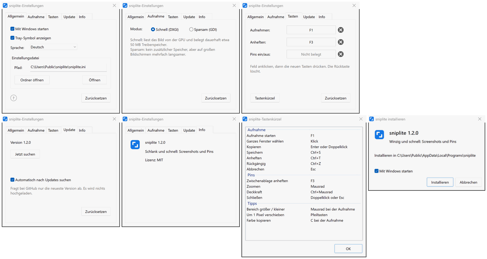

# sniplite

**Ein winziges, schnelles Werkzeug für Screenshots und Pins, im Kern in Assembler geschrieben**

       

  

[**Download**](#download) | [Standard-Tastenkürzel](#standard-tastenkürzel) | [Häufige Fragen](#häufige-fragen)

 
 

## Merkmale

- **Schnell**: F1 drücken, und der Screenshot ist da, schneller als bei 99 % der Screenshot-Programme
- **Schlank**: etwa 220 KB, nichts weiter zu installieren; der Kern für Aufnahme und Zeichnen ist in Assembler geschrieben
- **Pins**: einen Screenshot über allen Fenstern anheften, damit er beim Arbeiten im Blick bleibt
- **Komplett**: Screenshots, Pins, Pfeile, Text, Verpixeln, alles dabei
- **Sauber**: keine Werbung, Open Source, keine Protokolle, keine Datensammlung
- **Mehrsprachig**: 8 Sprachen; richtet sich nach Windows, solange Sie keine wählen

## Download

Den neuesten Installer gibt es unter [Releases](https://github.com/MrTangLuyao/sniplite/releases/latest).

> [!TIP]
> Das Symbol sitzt am rechten Ende der Taskleiste; ist es nicht zu sehen, klicken Sie dort auf den kleinen Pfeil. Damit es sichtbar bleibt, suchen Sie in den Windows-Einstellungen nach „Weitere Taskleistensymbole“ und schalten sniplite ein.

## Standard-Tastenkürzel

| Taste | Funktion |
| --- | --- |
| **F1** | Aufnehmen |
| **F3** | Kopiertes Bild oder kopierten Text anheften |
| **Shift+F3** | Alle Pins aus- / einblenden |
| **Enter** | Aufnahme kopieren |
| **Ctrl+S** | Aufnahme speichern |
| **Ctrl+T** | Aufnahme anheften |
| **Esc** | Aufnahme abbrechen |
| **Mausrad** | Bei der Aufnahme: größeres oder kleineres Fenster wählen; auf einem Pin: zoomen |
| **Doppelklick** | Pin schließen |

## Häufige Fragen

**Wie groß ist es?**

Winzig: unter 1 MB.

**Warum ist es so schnell?**

Die Teile, die schnell sein müssen (Aufnahme, Komposition, Zeichnen und Aufnahmeansicht), sind in x86-64-Assembler geschrieben, der Rest in C, ohne C-Laufzeitbibliothek. Ein Screenshot wird direkt von der Grafikkarte gelesen und Windows zur Komposition auf der GPU übergeben; das ist viel schneller als die üblichen Aufnahmewege unter Windows.

**Wie schneidet es im Vergleich ab?**

| Programm | Download | Speicher im Leerlauf | Vom Tastenkürzel bis bereit |
| --- | --- | --- | --- |
| **sniplite** | 0,3 MB | 11 MB | 12 ms |
| Snipaste 2.11.3 | 19 MB | 50 MB | 121 ms |
| PixPin 3.6.6 | 66 MB | 31 MB | 142 ms |
| Greenshot 1.3.328 | 4 MB | 16 MB | 252 ms |
| Flameshot 15.0.0 | 18 MB | 6 MB | nicht gemessen |
| ShareX 22.4.0 | 139 MB | 58 MB | nicht gemessen |

Das ist ein informeller Test, nur zur Orientierung.

**Wie viel Speicher braucht es?**

Meist etwa 50 MB, fast alles davon belegt der Grafiktreiber, direkt nach einer Aufnahme kurz etwas mehr. Wer weniger möchte, wählt in den Einstellungen auf der Seite Aufnahme den Modus Sparsam: etwa 2 MB, dafür langsamere Aufnahmen.

**Was bleibt auf meinem Rechner zurück?**

Es braucht keine Administratorrechte und fasst die Registrierung nicht an. Wer eine Einstellung ändert, bekommt eine Einstellungsdatei; wer sie löscht, hat wieder die Standardwerte.

**Wie ändere ich die Sprache?**

sniplite richtet sich nach der Sprache von Windows. Für eine andere öffnen Sie die Einstellungen über das Tray-Symbol und wählen sie unter Sprache.

**Wie aktualisiere ich es?**

Einmal am Tag fragt sniplite bei GitHub nach einer neueren Version. Gibt es eine, erscheint unten rechts ein Hinweis, und ein Klick aktualisiert. Geprüft wird nur die Versionsnummer, hochgeladen wird nichts; in den Einstellungen lässt sich das abschalten.

**Wie deinstalliere ich es?**

Klicken Sie im Startmenü im Ordner sniplite auf „sniplite deinstallieren“. Programm, Einstellungen und Verknüpfungen werden entfernt.

**Gibt es eine Befehlszeile?**

Ja. `sniplite help` zeigt alle Befehle.

## Einstellungen

## Selbst bauen

[w64devkit](https://github.com/skeeto/w64devkit) (oder ein anderes MinGW-w64) installieren, dessen Ordner `bin` in den PATH aufnehmen und `build.bat` ausführen; die Programme entstehen im Ordner `build`. Der Quelltext liegt in `src`: Die schnellen Teile sind Assemblerdateien (`.S`), die gcc mit dem GNU-Assembler übersetzt, der Rest ist C (`.c`). Es wird keine C-Laufzeitbibliothek gelinkt, nur die Systembibliotheken, die Windows mitbringt.

## Lizenz

[MIT](../LICENSE)
