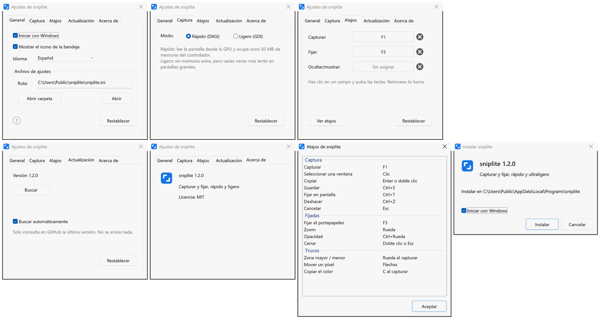

# sniplite

**Una herramienta diminuta y rápida para capturar la pantalla y fijar imágenes, con el núcleo escrito en ensamblador**

       

  

[**Descargar**](#descargar) | [Atajos predeterminados](#atajos-predeterminados) | [Preguntas frecuentes](#preguntas-frecuentes)

 
 
 

 

## Características

- **Rápido**: pulsa F1 y la captura está ahí, antes que en el 99 % de las herramientas de captura
- **Ligero**: unos 320 KB, sin nada más que instalar; el núcleo de captura y dibujo está escrito en ensamblador
- **Fijar**: fija una captura por encima de todas las ventanas para tenerla a la vista mientras trabajas
- **Completo**: capturas, imágenes fijadas, flechas, texto, mosaico, foco, lupa: no falta nada
- **Medir**: una regla de pantalla mide la distancia, el tamaño y el ángulo entre dos puntos; Mayús ajusta a 0°/45°/90°, Alt mide desde el centro e Intro copia la lectura; la regla de borde mantiene marcas en el borde superior e izquierdo, con una cruz fina que sigue el ratón, un cuadro de coordenadas y una lupa de píxeles al detenerse
- **Reconocimiento de texto**: lee el texto de una captura, tablas incluidas; un módulo opcional que funciona por completo en tu equipo
- **Capturas con desplazamiento**: desplaza la página y se va uniendo sola
- **Limpio**: sin anuncios, de código abierto, sin archivos de registro, sin recopilar datos
- **Multilingüe**: 8 idiomas; sigue el de Windows salvo que elijas otro

## Descargar

Descarga el instalador más reciente en [Releases](https://github.com/MrTangLuyao/sniplite/releases/latest).

También hay dos versiones portables, sin instalación: `sniplite_<versión>_portable_x64.exe`, y `sniplite_<versión>_portable_with_OCR_x64.exe`, que incluye el módulo de reconocimiento de texto.

> [!TIP]
> El icono está en el extremo derecho de la barra de tareas; si no lo ves, haz clic en la flecha pequeña. Para tenerlo siempre a la vista, busca «Otros iconos de la bandeja del sistema» en la configuración de Windows y activa sniplite.

## Atajos predeterminados

| Tecla | Qué hace |
| --- | --- |
| **F1** | Capturar |
| **Shift+F1** | Captura rápida: la pantalla donde está el ratón, directamente a un archivo (la carpeta se elige en los ajustes) |
| **F2** | Selector de color: haz clic para copiar el color y seguir eligiendo; Mayús alterna HEX / RGB; Esc o clic derecho cierra |
| **R** (en el cuentagotas o la regla) | Cambiar entre el cuentagotas y la regla de pantalla |
| **C** (durante una captura) | Copiar el color bajo el cursor |
| **F3** | Fijar en pantalla la imagen o el texto copiado |
| **Shift+F3** | Ocultar / mostrar todas las imágenes fijadas |
| **F4** | Capturar y leer el texto (con el módulo de reconocimiento de texto) |
| **Shift+F4** | Capturar y copiar el texto |
| **Enter** | Copiar la captura |
| **Ctrl+S** | Guardar la captura |
| **Ctrl+T** | Fijar la captura en pantalla |
| **Clic central** | Fijar la captura en pantalla |
| **Ctrl+O** | Reconocer el texto de la selección |
| **Ctrl+Shift+C** | Copiar el texto de la selección |
| **Ctrl+L** | Captura con desplazamiento: desplaza y se une sola |
| **Esc** | Cancelar la captura |
| **Flechas**, **W A S D** | Mover el cursor o la selección un píxel; con Shift, diez |
| **Rueda** | Al capturar: elegir una ventana mayor o menor; sobre una imagen fijada: zoom |
| **Doble clic** | Cerrar una imagen fijada |

## Preguntas frecuentes

**¿Cuánto ocupa?**

Muy poco: menos de 1 MB.

**¿Por qué es tan rápido?**

Las partes que deben ser rápidas (captura, composición, dibujo y la pantalla de captura) están escritas en ensamblador x86-64 y el resto en C, sin el runtime de C. La captura se lee directamente de la tarjeta gráfica y se entrega a Windows para componerla en la GPU, mucho más rápido que los métodos habituales de captura en Windows.

**¿Cómo se compara con otras herramientas?**

| Programa | Descarga | Memoria en reposo | Del atajo a listo |
| --- | --- | --- | --- |
| **sniplite** | 0,4 MB | 11 MB | 12 ms |
| Snipaste 2.11.3 | 19 MB | 50 MB | 121 ms |
| PixPin 3.6.6 | 66 MB | 31 MB | 142 ms |
| Greenshot 1.3.328 | 4 MB | 16 MB | 252 ms |
| Flameshot 15.0.0 | 18 MB | 6 MB | sin medir |
| ShareX 22.4.0 | 139 MB | 58 MB | sin medir |

Es una prueba informal, solo como referencia.

**¿Cómo saco el texto de una captura?**

Selecciona una zona y pulsa el botón de texto (Ctrl+O): el texto aparece en un panel junto a la selección, donde puedes seleccionarlo, editarlo y copiarlo. Una tabla conserva sus columnas y se pega en una hoja de cálculo celda por celda, o como Markdown si lo prefieres. Ctrl+Shift+C copia el texto directamente. Hace falta el módulo de reconocimiento de texto (12 MB; los modelos PaddleOCR PP-OCRv6 con ONNX Runtime, todo en tu equipo): instálalo en la pestaña OCR de los ajustes, márcalo en el instalador o usa la versión portable con OCR. Mientras no esté instalado, los botones de texto no se muestran. F4 y Shift+F4 inician una captura que lee o copia el texto al momento.

**¿Cómo cojo un color?**

Pulsa F2 (o ejecuta `sniplite pick`) y aparece un selector de color con lupa sobre la pantalla. Haz clic para copiar el color y seguir eligiendo; Mayús alterna entre `#RRGGBB` y `R, G, B`; Esc o el clic derecho lo cierran. Durante una captura normal, C también copia el color bajo el cursor.

**¿Cómo hago una captura larga?**

Selecciona la zona, pulsa el botón de captura con desplazamiento (Ctrl+L) y desplaza la página tú mismo. sniplite une lo que va pasando, y una franja junto a la zona muestra el resultado. Enter copia y Esc cancela; también puedes guardarla, fijarla o leer su texto.

**¿Dónde se guardan las capturas?**

Ctrl+S abre el cuadro de diálogo de guardar en la última carpeta que usaste; la primera vez, o si esa carpeta ya no existe, en la carpeta de guardado predeterminada si la cambiaste, y si no, en Imágenes. Las capturas rápidas (Shift+F1) van directamente a la carpeta de guardado predeterminada: el escritorio, mientras no la cambies en la pestaña Captura de los ajustes. Marca allí «Guardar también cada captura en un archivo» y cada captura que copies o fijes se guarda también en esa carpeta. En «Formato del nombre», en la misma pestaña, eliges cómo se llaman los archivos, entre unos cuantos formatos de fecha y hora.

**¿Y si los atajos molestan en un juego?**

En la pestaña Atajos de los ajustes, marca «Ceder los atajos en pantalla completa (juegos, etc.)»: mientras un programa que ocupa toda la pantalla está en primer plano, sniplite libera sus atajos y las teclas le llegan a ese programa; los recupera cuando cambias a otra cosa. Los programas que no se ejecutan a pantalla completa se pueden añadir en «Ceder los atajos a»: haz clic en «Gestionar» y luego en «Nuevo» para escribir un nombre de archivo como `game.exe`, o en «Examinar» para elegir el programa.

**¿Cuánta memoria usa?**

Unos 50 MB casi siempre, la mayor parte ocupada por el controlador gráfico, y un poco más justo después de capturar. Para usar menos, elige Ligero en la pestaña Captura de los ajustes: unos 2 MB, con capturas más lentas.

**¿Qué deja en mi equipo?**

No necesita permisos de administrador ni toca el registro. Al cambiar un ajuste, o al guardar con el cuadro de diálogo de guardar (que recuerda la carpeta), se crea un archivo de ajustes; bórralo para volver a los valores predeterminados.

**¿Cómo cambio el idioma?**

sniplite sigue el idioma de Windows. Para usar otro, abre los ajustes desde el icono de la bandeja y elígelo en Idioma.

**¿Cómo se actualiza?**

Una vez al día, sniplite pregunta a GitHub si hay una versión más reciente. Si la hay, aparece un aviso abajo a la derecha y un clic lo actualiza. Solo se comprueba el número de versión y no se envía nada; puedes desactivarlo en los ajustes. Las versiones portables no buscan actualizaciones: descarga la nueva en [Releases](https://github.com/MrTangLuyao/sniplite/releases/latest).

**¿Cómo se desinstala?**

Haz clic en «Desinstalar sniplite» en la carpeta sniplite del menú Inicio. Se eliminan el programa, sus ajustes y sus accesos directos.

**¿Tiene línea de comandos?**

Sí. Ejecuta `sniplite help` para ver los comandos.

## Ajustes

## Compilarlo tú mismo

Instala [w64devkit](https://github.com/skeeto/w64devkit) (u otro MinGW-w64), añade su carpeta `bin` al PATH y ejecuta `build.bat`; los programas aparecen en la carpeta `build`. El código está en `src`: las partes rápidas son archivos en ensamblador (`.S`), ensamblados por gcc con el ensamblador de GNU, y el resto es C (`.c`). No se enlaza el runtime de C, solo las bibliotecas del sistema que trae Windows.

## Licencia

[MIT](../LICENSE)

## Software libre de terceros

sniplite en sí solo usa las bibliotecas del sistema de Windows. El módulo opcional de reconocimiento de texto es obra de otros y se distribuye sin cambios, con sus licencias o enlaces a ellas (en la carpeta `ocr` del módulo y en la [página del módulo](https://github.com/MrTangLuyao/sniplite/releases/tag/ocr-2)):

- [ONNX Runtime](https://github.com/microsoft/onnxruntime) 1.26.0, Copyright (c) Microsoft Corporation, licencia MIT
- El runtime de [Microsoft Visual C++](https://learn.microsoft.com/cpp/windows/redistributing-visual-cpp-files) 14.51.36247 que ONNX Runtime necesita (`msvcp140.dll`, `msvcp140_1.dll`, `vcruntime140.dll`, `vcruntime140_1.dll`), Copyright (c) Microsoft Corporation, no es de código abierto: se redistribuye según los [términos de licencia](https://visualstudio.microsoft.com/license-terms/) de Microsoft
- Los modelos PP-OCRv6 de [PaddleOCR](https://github.com/PaddlePaddle/PaddleOCR), Copyright (c) PaddlePaddle Authors, licencia Apache 2.0
- Su versión ONNX procede de [RapidOCR](https://github.com/RapidAI/RapidOCR), licencia Apache 2.0
