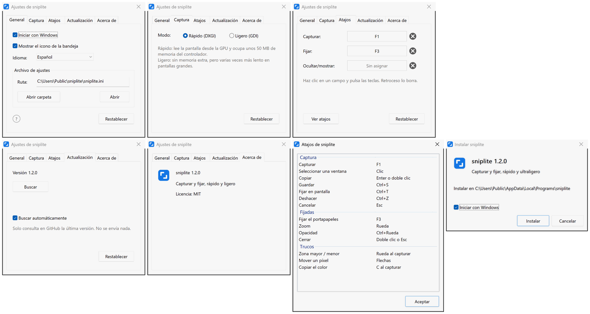

# sniplite

**Una herramienta diminuta y rápida para capturar la pantalla y fijar imágenes, con el núcleo escrito en ensamblador**

       

  

[**Descargar**](#descargar) | [Atajos predeterminados](#atajos-predeterminados) | [Preguntas frecuentes](#preguntas-frecuentes)

 
 

## Características

- **Rápido**: pulsa F1 y la captura está ahí, antes que en el 99 % de las herramientas de captura
- **Ligero**: unos 220 KB, sin nada más que instalar; el núcleo de captura y dibujo está escrito en ensamblador
- **Fijar**: fija una captura por encima de todas las ventanas para tenerla a la vista mientras trabajas
- **Completo**: capturas, imágenes fijadas, flechas, texto, mosaico: no falta nada
- **Limpio**: sin anuncios, de código abierto, sin archivos de registro, sin recopilar datos
- **Multilingüe**: 8 idiomas; sigue el de Windows salvo que elijas otro

## Descargar

Descarga el instalador más reciente en [Releases](https://github.com/MrTangLuyao/sniplite/releases/latest).

> [!TIP]
> El icono está en el extremo derecho de la barra de tareas; si no lo ves, haz clic en la flecha pequeña. Para tenerlo siempre a la vista, busca «Otros iconos de la bandeja del sistema» en la configuración de Windows y activa sniplite.

## Atajos predeterminados

| Tecla | Qué hace |
| --- | --- |
| **F1** | Capturar |
| **F3** | Fijar en pantalla la imagen o el texto copiado |
| **Shift+F3** | Ocultar / mostrar todas las imágenes fijadas |
| **Enter** | Copiar la captura |
| **Ctrl+S** | Guardar la captura |
| **Ctrl+T** | Fijar la captura en pantalla |
| **Esc** | Cancelar la captura |
| **Rueda** | Al capturar: elegir una ventana mayor o menor; sobre una imagen fijada: zoom |
| **Doble clic** | Cerrar una imagen fijada |

## Preguntas frecuentes

**¿Cuánto ocupa?**

Muy poco: menos de 1 MB.

**¿Por qué es tan rápido?**

Las partes que deben ser rápidas (captura, composición, dibujo y la pantalla de captura) están escritas en ensamblador x86-64 y el resto en C, sin el runtime de C. La captura se lee directamente de la tarjeta gráfica y se entrega a Windows para componerla en la GPU, mucho más rápido que los métodos habituales de captura en Windows.

**¿Cuánta memoria usa?**

Unos 50 MB casi siempre, la mayor parte ocupada por el controlador gráfico, y un poco más justo después de capturar. Para usar menos, elige Ligero en la pestaña Captura de los ajustes: unos 2 MB, con capturas más lentas.

**¿Qué deja en mi equipo?**

No necesita permisos de administrador ni toca el registro. Al cambiar un ajuste se crea un archivo de ajustes; bórralo para volver a los valores predeterminados.

**¿Cómo cambio el idioma?**

sniplite sigue el idioma de Windows. Para usar otro, abre los ajustes desde el icono de la bandeja y elígelo en Idioma.

**¿Cómo se actualiza?**

Una vez al día, sniplite pregunta a GitHub si hay una versión más reciente. Si la hay, aparece un aviso abajo a la derecha y un clic lo actualiza. Solo se comprueba el número de versión y no se envía nada; puedes desactivarlo en los ajustes.

**¿Cómo se desinstala?**

Haz clic en «Desinstalar sniplite» en la carpeta sniplite del menú Inicio. Se eliminan el programa, sus ajustes y sus accesos directos.

**¿Tiene línea de comandos?**

Sí. Ejecuta `sniplite help` para ver los comandos.

## Ajustes

## Compilarlo tú mismo

Instala [w64devkit](https://github.com/skeeto/w64devkit) (u otro MinGW-w64), añade su carpeta `bin` al PATH y ejecuta `build.bat`; los programas aparecen en la carpeta `build`. El código está en `src`: las partes rápidas son archivos en ensamblador (`.S`), ensamblados por gcc con el ensamblador de GNU, y el resto es C (`.c`). No se enlaza el runtime de C, solo las bibliotecas del sistema que trae Windows.

## Licencia

[MIT](../LICENSE)
