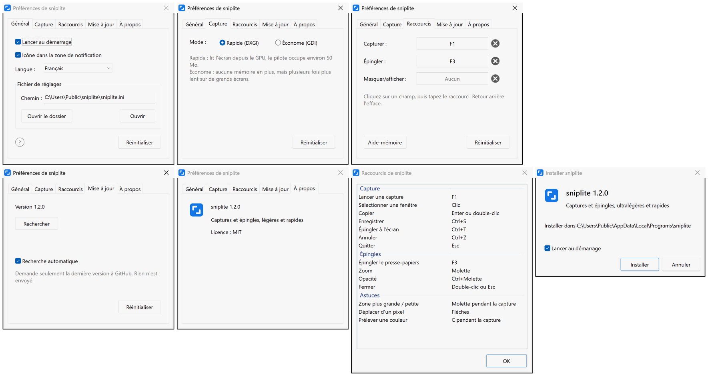

# sniplite

**Un outil de capture d'écran et d'épinglage minuscule et rapide, dont le cœur est écrit en assembleur**

       

  

[**Télécharger**](#télécharger) | [Raccourcis par défaut](#raccourcis-par-défaut) | [Questions fréquentes](#questions-fréquentes)

 
 
 

 

## Points forts

- **Rapide** : appuyez sur F1 et la capture est là, plus vite qu'avec 99 % des outils de capture
- **Léger** : environ 360 Ko, rien d'autre à installer ; le cœur de la capture et du dessin est écrit en assembleur
- **Épingles** : épinglez une capture au-dessus de toutes les fenêtres pour la garder sous les yeux pendant que vous travaillez
- **Complet** : captures, épingles, flèches, texte, mosaïque, projecteur, loupe : tout y est
- **Mesurer** : une règle d'écran mesure la distance, la taille et l'angle entre deux points ; Maj accroche à 0°/45°/90°, Alt mesure depuis le centre et Entrée copie le relevé ; la règle de bord garde des graduations en haut et à gauche de l'écran, avec un fin réticule qui suit la souris, un cadre de coordonnées et une loupe de pixels à l'arrêt
- **Reconnaissance de texte** : lit le texte d'une capture, tableaux compris ; un module facultatif qui fonctionne entièrement sur votre ordinateur
- **Captures défilantes** : faites défiler une page, elle est assemblée au fur et à mesure
- **Enregistrement** : sélectionnez une zone et appuyez sur Ctrl+R pour l'enregistrer avec le pointeur en MP4 (H.264, 30 i/s) ; la barre permet de mettre en pause ; le menu de la zone de notification ou Ctrl+Alt+R lance l'enregistrement dès que la zone est choisie
- **Propre** : sans publicité, open source, sans journaux, sans collecte de données
- **Multilingue** : 8 langues ; suit celle de Windows, sauf si vous en choisissez une

## Télécharger

Récupérez le dernier installeur dans [Releases](https://github.com/MrTangLuyao/sniplite/releases/latest).

Il existe aussi deux versions portables, sans installation : `sniplite_<version>_portable_x64.exe`, et `sniplite_<version>_portable_with_OCR_x64.exe`, qui contient le module de reconnaissance de texte.

> [!TIP]
> L'icône se trouve à droite de la barre des tâches ; si vous ne la voyez pas, cliquez sur la petite flèche. Pour la garder visible, cherchez « Autres icônes de la barre d'état système » dans les paramètres de Windows et activez sniplite.

## Raccourcis par défaut

| Touche | Action |
| --- | --- |
| **F1** | Capturer |
| **Shift+F1** | Capture rapide : l'écran où se trouve la souris, directement dans un fichier (dossier à choisir dans les préférences) |
| **F2** | Pipette : cliquez pour copier la couleur et continuer ; Maj bascule HEX / RVB ; Échap ou clic droit ferme |
| **R** (dans la pipette ou la règle) | Passer de la pipette à la règle d'écran, et inversement |
| **C** (pendant une capture) | Copier la couleur sous le curseur |
| **F3** | Épingler à l'écran l'image ou le texte copié |
| **Shift+F3** | Masquer / afficher toutes les épingles |
| **F4** | Capturer et lire le texte (avec le module de reconnaissance de texte) |
| **Shift+F4** | Capturer et copier le texte |
| **Enter** | Copier la capture |
| **Ctrl+S** | Enregistrer la capture |
| **Ctrl+T** | Épingler la capture à l'écran |
| **Clic du milieu** | Épingler la capture à l'écran |
| **Ctrl+O** | Reconnaître le texte de la sélection |
| **Ctrl+Shift+C** | Copier le texte de la sélection |
| **Ctrl+L** | Capture défilante : faites défiler, elle s'assemble |
| **Ctrl+R** | Enregistrer la sélection en vidéo MP4 ; cliquez sur le bouton d'arrêt ou appuyez sur Esc pour terminer |
| **Ctrl+Alt+R** | Lancer un enregistrement : choisissez la zone, l'enregistrement démarre aussitôt (modifiable dans Préférences → Raccourcis) |
| **Bouton pause** | Met l'enregistrement en pause ou le reprend ; le temps en pause n'est pas dans la vidéo |
| **Esc** | Annuler la capture |
| **Flèches**, **W A S D** | Déplacer le curseur ou la sélection d'un pixel ; de dix avec Shift |
| **Molette** | Pendant la capture : choisir une fenêtre plus grande ou plus petite ; sur une épingle : zoomer |
| **Double-clic** | Fermer une épingle |

## Questions fréquentes

**Quelle est sa taille ?**

Minuscule : moins de 1 Mo.

**Pourquoi est-il si rapide ?**

Les parties qui doivent aller vite (capture, composition, dessin et écran de capture) sont écrites en assembleur x86-64, le reste en C, sans bibliothèque d'exécution C. La capture est lue directement depuis la carte graphique et confiée à Windows pour être composée sur le GPU, ce qui est bien plus rapide que les méthodes de capture habituelles de Windows.

**Et par rapport aux autres outils ?**

| Outil | Téléchargement | Mémoire au repos | Délai après le raccourci |
| --- | --- | --- | --- |
| **sniplite** | 0,4 Mo | 11 Mo | 12 ms |
| Snipaste 2.11.3 | 19 Mo | 50 Mo | 121 ms |
| PixPin 3.6.6 | 66 Mo | 31 Mo | 142 ms |
| Greenshot 1.3.328 | 4 Mo | 16 Mo | 252 ms |
| Flameshot 15.0.0 | 18 Mo | 6 Mo | non mesuré |
| ShareX 22.4.0 | 139 Mo | 58 Mo | non mesuré |

Test informel, à titre indicatif seulement.

**Comment récupérer le texte d'une capture ?**

Sélectionnez une zone et cliquez sur le bouton de texte (Ctrl+O) : le texte apparaît dans un panneau à côté de la sélection, où vous pouvez le sélectionner, le modifier et le copier. Un tableau garde ses colonnes et se colle dans un tableur cellule par cellule, ou en Markdown si vous préférez. Ctrl+Shift+C copie le texte directement. Il faut le module de reconnaissance de texte (12 Mo ; les modèles PaddleOCR PP-OCRv6 avec ONNX Runtime, entièrement sur votre ordinateur) : installez-le depuis l'onglet OCR des préférences, cochez-le dans l'installeur, ou prenez la version portable avec OCR. Tant qu'il n'est pas installé, les boutons de texte ne sont pas affichés. F4 et Shift+F4 lancent une capture qui lit ou copie le texte aussitôt.

**Comment prélever une couleur ?**

Appuyez sur F2 (ou lancez `sniplite pick`) : une pipette avec loupe apparaît sur l'écran. Cliquez pour copier la couleur et continuer ; Maj bascule entre `#RRGGBB` et `R, G, B` ; Échap ou un clic droit ferme la pipette. Pendant une capture normale, C copie aussi la couleur sous le curseur.

**Comment faire une capture défilante ?**

Sélectionnez la zone, cliquez sur le bouton de capture défilante (Ctrl+L) et faites défiler la page vous-même. sniplite assemble ce qui défile, et une bande à côté de la zone montre le résultat. Enter copie et Esc annule ; vous pouvez aussi enregistrer, épingler ou lire le texte.

**Comment enregistrer l'écran ?**

Sélectionnez la zone et appuyez sur Ctrl+R : une petite barre apparaît avec le temps écoulé, un bouton de pause et un bouton d'arrêt ; cliquez sur l'arrêt ou appuyez sur Esc pour terminer, et le MP4 est enregistré là où vont vos captures, avec une notification. Cliquez sur pause (ou appuyez sur Espace quand la barre a le focus) pour mettre en pause, et le temps de pause n'est pas dans la vidéo ; le pointeur de la souris est enregistré aussi. L'enregistrement utilise la carte graphique (duplication de bureau DXGI et Media Foundation), nécessite Windows 10 ou 11 et couvre un seul écran à la fois ; les contenus protégés par le matériel (certains lecteurs, vidéos DRM) apparaissent en noir. La barre d'enregistrement n'apparaît pas dans la vidéo.

**Où sont enregistrées les captures ?**

Ctrl+S ouvre la fenêtre d'enregistrement dans le dernier dossier utilisé ; la première fois, ou si ce dossier n'existe plus, dans le dossier d'enregistrement par défaut si vous l'avez changé, sinon dans Images. Les captures rapides (Shift+F1) vont directement dans le dossier d'enregistrement par défaut : le bureau, tant que vous ne le changez pas dans l'onglet Capture des préférences. Cochez-y « Enregistrer aussi chaque capture dans un fichier » : chaque capture copiée ou épinglée est alors aussi enregistrée dans ce dossier. Dans le même onglet, « Format du nom » permet de choisir comment les fichiers sont nommés, parmi quelques modèles avec la date et l'heure.

**Et si les raccourcis gênent un jeu ?**

Dans l'onglet Raccourcis des préférences, cochez « Laisser les raccourcis aux applis plein écran (jeux…) » : tant qu'un programme qui occupe tout l'écran est au premier plan, sniplite libère ses raccourcis et les touches vont à ce programme ; il les reprend quand vous passez à autre chose. Les programmes qui ne tournent pas en plein écran peuvent être ajoutés sous « Laisser les raccourcis à » : cliquez sur « Gérer », puis sur « Nouveau » pour taper un nom de fichier comme `game.exe`, ou sur « Parcourir » pour choisir le programme.

**Combien de mémoire utilise-t-il ?**

Environ 50 Mo la plupart du temps, presque entièrement pris par le pilote graphique, et un peu plus juste après une capture. Pour en utiliser moins, choisissez « Économe » dans l'onglet Capture des préférences : environ 2 Mo, avec des captures plus lentes.

**Que laisse-t-il sur mon ordinateur ?**

Il ne demande pas de droits d'administrateur et ne touche pas au registre. Modifier un réglage, ou enregistrer avec la fenêtre d'enregistrement (qui retient le dossier), crée un fichier de réglages ; supprimez-le pour revenir aux valeurs par défaut.

**Comment changer de langue ?**

sniplite suit la langue de Windows. Pour en utiliser une autre, ouvrez les préférences depuis l'icône de la zone de notification et choisissez-la dans Langue.

**Comment le mettre à jour ?**

Une fois par jour, sniplite demande à GitHub s'il existe une version plus récente. Si oui, une notification apparaît en bas à droite, et un clic suffit pour mettre à jour. Seul le numéro de version est vérifié, rien n'est envoyé ; vous pouvez désactiver cela dans les préférences. Les versions portables ne recherchent pas les mises à jour : téléchargez la nouvelle depuis [Releases](https://github.com/MrTangLuyao/sniplite/releases/latest).

**Comment le désinstaller ?**

Cliquez sur « Désinstaller sniplite » dans le dossier sniplite du menu Démarrer. Le programme, ses réglages et ses raccourcis sont supprimés.

**Y a-t-il une ligne de commande ?**

Oui. Lancez `sniplite help` pour la découvrir.

## Préférences

## Le compiler soi-même

Installez [w64devkit](https://github.com/skeeto/w64devkit) (ou un autre MinGW-w64), ajoutez son dossier `bin` au PATH et lancez `build.bat` ; les programmes apparaissent dans le dossier `build`. Les sources sont dans `src` : les parties rapides sont des fichiers assembleur (`.S`), assemblés par gcc avec l'assembleur GNU, le reste est en C (`.c`). Aucune bibliothèque d'exécution C n'est liée, seulement les bibliothèques système fournies avec Windows.

## Licence

[MIT](../LICENSE)

## Logiciels libres tiers

sniplite lui-même n'utilise que les bibliothèques système de Windows. Le module facultatif de reconnaissance de texte est le travail d'autres personnes, redistribué tel quel avec leurs licences ou des liens vers celles-ci (dans le dossier `ocr` du module et sur la [page du module](https://github.com/MrTangLuyao/sniplite/releases/tag/ocr-2)) :

- [ONNX Runtime](https://github.com/microsoft/onnxruntime) 1.26.0, Copyright (c) Microsoft Corporation, licence MIT
- Le runtime [Microsoft Visual C++](https://learn.microsoft.com/cpp/windows/redistributing-visual-cpp-files) 14.51.36247 dont ONNX Runtime a besoin (`msvcp140.dll`, `msvcp140_1.dll`, `vcruntime140.dll`, `vcruntime140_1.dll`), Copyright (c) Microsoft Corporation, pas open source : redistribué selon les [conditions de licence](https://visualstudio.microsoft.com/license-terms/) de Microsoft
- Les modèles PP-OCRv6 de [PaddleOCR](https://github.com/PaddlePaddle/PaddleOCR), Copyright (c) PaddlePaddle Authors, licence Apache 2.0
- Leur version ONNX vient de [RapidOCR](https://github.com/RapidAI/RapidOCR), licence Apache 2.0
