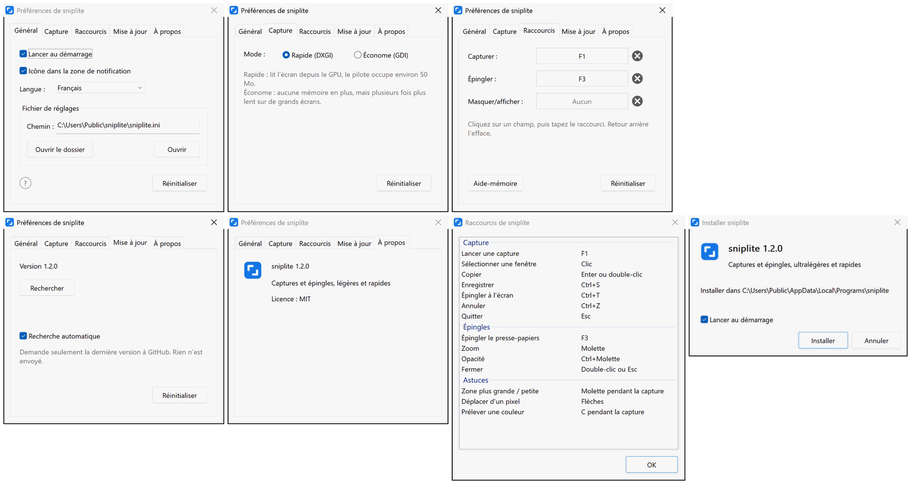

# sniplite

**Un outil de capture d'écran et d'épinglage minuscule et rapide, dont le cœur est écrit en assembleur**

       

  

[**Télécharger**](#télécharger) | [Raccourcis par défaut](#raccourcis-par-défaut) | [Questions fréquentes](#questions-fréquentes)

 
 

## Points forts

- **Rapide** : appuyez sur F1 et la capture est là, plus vite qu'avec 99 % des outils de capture
- **Léger** : environ 220 Ko, rien d'autre à installer ; le cœur de la capture et du dessin est écrit en assembleur
- **Épingles** : épinglez une capture au-dessus de toutes les fenêtres pour la garder sous les yeux pendant que vous travaillez
- **Complet** : captures, épingles, flèches, texte, mosaïque : tout y est
- **Propre** : sans publicité, open source, sans journaux, sans collecte de données
- **Multilingue** : 8 langues ; suit celle de Windows, sauf si vous en choisissez une

## Télécharger

Récupérez le dernier installeur dans [Releases](https://github.com/MrTangLuyao/sniplite/releases/latest).

> [!TIP]
> L'icône se trouve à droite de la barre des tâches ; si vous ne la voyez pas, cliquez sur la petite flèche. Pour la garder visible, cherchez « Autres icônes de la barre d'état système » dans les paramètres de Windows et activez sniplite.

## Raccourcis par défaut

| Touche | Action |
| --- | --- |
| **F1** | Capturer |
| **F3** | Épingler à l'écran l'image ou le texte copié |
| **Shift+F3** | Masquer / afficher toutes les épingles |
| **Enter** | Copier la capture |
| **Ctrl+S** | Enregistrer la capture |
| **Ctrl+T** | Épingler la capture à l'écran |
| **Esc** | Annuler la capture |
| **Molette** | Pendant la capture : choisir une fenêtre plus grande ou plus petite ; sur une épingle : zoomer |
| **Double-clic** | Fermer une épingle |

## Questions fréquentes

**Quelle est sa taille ?**

Minuscule : moins de 1 Mo.

**Pourquoi est-il si rapide ?**

Les parties qui doivent aller vite (capture, composition, dessin, écran de capture et épingles) sont écrites en assembleur x86-64, le reste en C, sans bibliothèque d'exécution C. La capture est lue directement depuis la carte graphique et confiée à Windows pour être composée sur le GPU, ce qui est bien plus rapide que les méthodes de capture habituelles de Windows.

**Combien de mémoire utilise-t-il ?**

Environ 50 Mo la plupart du temps, presque entièrement pris par le pilote graphique, et un peu plus juste après une capture. Pour en utiliser moins, choisissez « Économe » dans l'onglet Capture des préférences : environ 2 Mo, avec des captures plus lentes.

**Que laisse-t-il sur mon ordinateur ?**

Il ne demande pas de droits d'administrateur et ne touche pas au registre. Modifier un réglage crée un fichier de réglages ; supprimez-le pour revenir aux valeurs par défaut.

**Comment changer de langue ?**

sniplite suit la langue de Windows. Pour en utiliser une autre, ouvrez les préférences depuis l'icône de la zone de notification et choisissez-la dans Langue.

**Comment le mettre à jour ?**

Une fois par jour, sniplite demande à GitHub s'il existe une version plus récente. Si oui, une notification apparaît en bas à droite, et un clic suffit pour mettre à jour. Seul le numéro de version est vérifié, rien n'est envoyé ; vous pouvez désactiver cela dans les préférences.

**Comment le désinstaller ?**

Cliquez sur « Désinstaller sniplite » dans le dossier sniplite du menu Démarrer. Le programme, ses réglages et ses raccourcis sont supprimés.

**Y a-t-il une ligne de commande ?**

Oui. Lancez `sniplite help` pour la découvrir.

## Préférences

## Le compiler soi-même

Installez [w64devkit](https://github.com/skeeto/w64devkit) (ou un autre MinGW-w64), ajoutez son dossier `bin` au PATH et lancez `build.bat` ; les programmes apparaissent dans le dossier `build`. Les sources sont dans `src` : les parties rapides sont des fichiers assembleur (`.S`), assemblés par gcc avec l'assembleur GNU, le reste est en C (`.c`). Aucune bibliothèque d'exécution C n'est liée, seulement les bibliothèques système fournies avec Windows.

## Licence

[MIT](../LICENSE)
