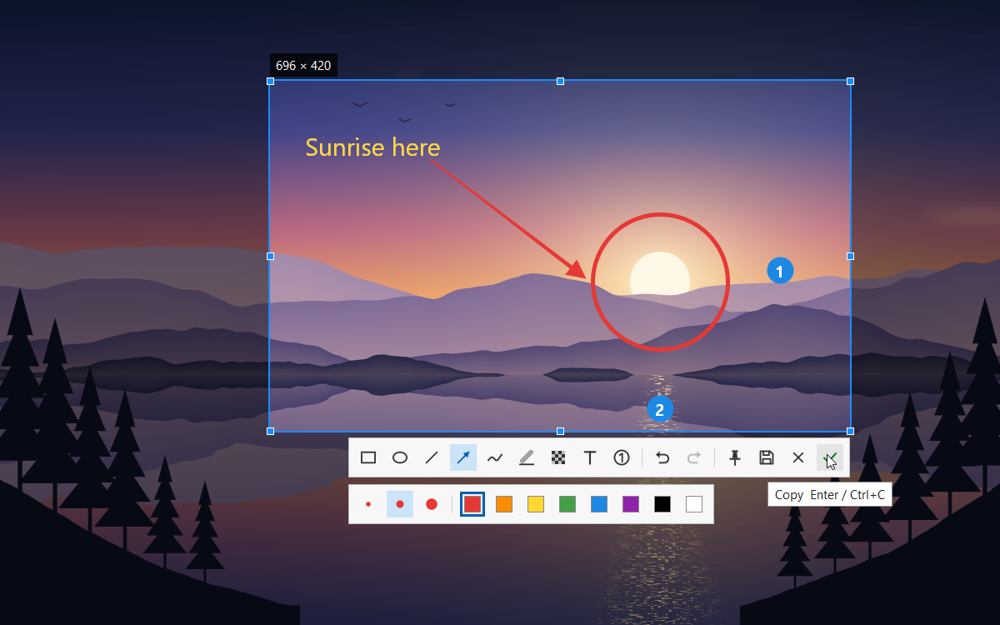
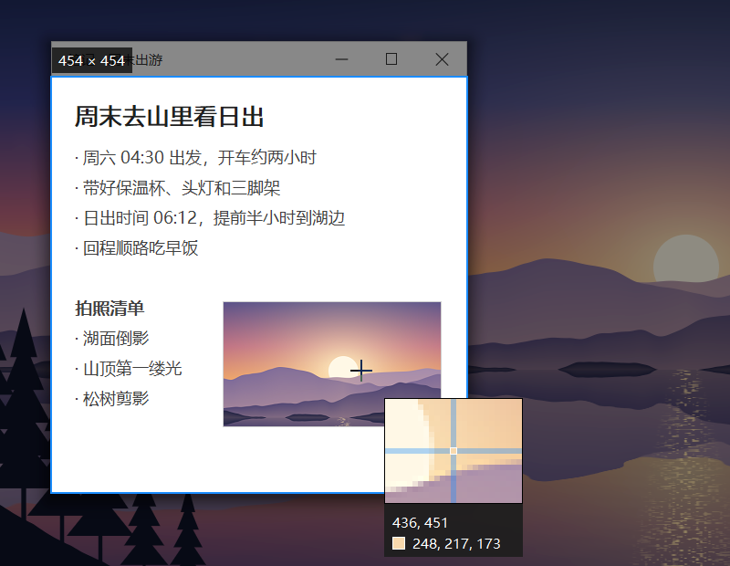
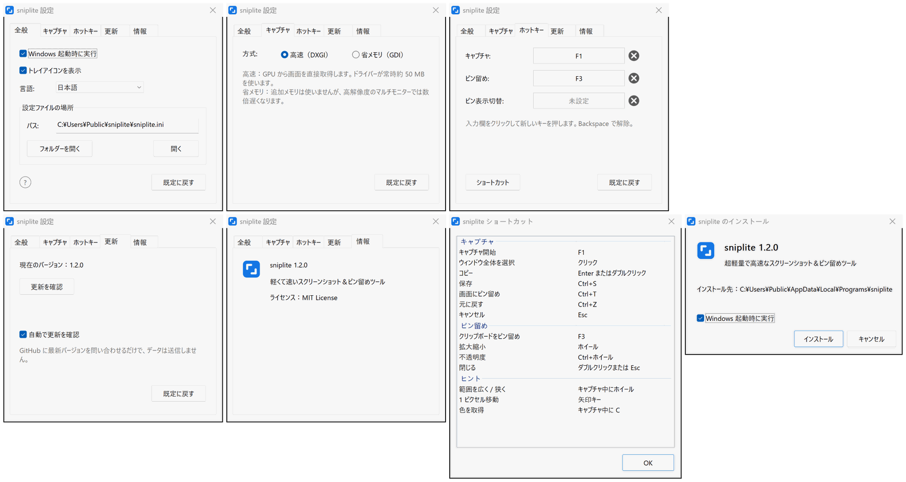

# sniplite

**とても軽くて速い、スクリーンショットとピン留めのツール。コア部分はアセンブリ言語で書かれています**

       

  

[**ダウンロード**](#ダウンロード) | [既定のショートカット](#既定のショートカット) | [よくある質問](#よくある質問)

 
 
 

 

## 特長

- **速い**：F1 を押せばすぐキャプチャ。99% のスクリーンショットソフトより速く表示されます
- **軽い**：本体は約 280 KB。ランタイムのインストールは不要で、キャプチャと描画のコア部分はアセンブリ言語です
- **ピン留め**：スクリーンショットを最前面に固定。ほかのウィンドウに切り替えても隠れないので、見比べるのに便利です
- **十分な機能**：キャプチャ、ピン留め、矢印、文字、モザイクがひととおり揃っています
- **文字認識**：キャプチャ内の文字や表を読み取れます。任意で追加するモジュールで、すべてこのパソコン上で動きます
- **スクロールキャプチャ**：ページをスクロールすると、その場でつなぎ合わせます
- **クリーン**：広告なし、オープンソース、ログなし、データ収集なし
- **多言語**：8 言語に対応。既定では Windows の言語に従い、自分で選ぶこともできます

## ダウンロード

[Releases](https://github.com/MrTangLuyao/sniplite/releases/latest) から最新版のインストーラーを入手してください。

インストール不要のポータブル版も 2 つあります。`sniplite_<バージョン>_portable_x64.exe` と、文字認識モジュールを含む `sniplite_<バージョン>_portable_with_OCR_x64.exe` です。

**macOS**：macOS 14 以降（Apple シリコンと Intel）向けのネイティブ版は [`macos`](../macos/README.md) にあります。`macos/build.sh` でビルドし、`sniplite.app` を「アプリケーション」にコピーしたら、公証されていないため一度 `xattr -dr com.apple.quarantine "/Applications/sniplite.app"` を実行してください。

> [!TIP]
> アイコンはタスクバーの右端にあります。見当たらないときは、そこの小さな矢印をクリックしてください。常に表示するには、Windows の設定で **その他のシステム トレイ アイコン** を検索し、sniplite をオンにします。

## 既定のショートカット

| キー | 動作 |
| --- | --- |
| **F1** | キャプチャ |
| **F3** | コピーした画像や文字を画面にピン留め |
| **Shift+F3** | すべてのピンを隠す / 表示 |
| **F4** | キャプチャして文字を読み取る（文字認識モジュールが必要） |
| **Shift+F4** | キャプチャして文字をそのままコピー |
| **Enter** | キャプチャをコピー |
| **Ctrl+S** | キャプチャを保存 |
| **Ctrl+T** | キャプチャを画面にピン留め |
| **中クリック** | キャプチャを画面にピン留め |
| **Ctrl+O** | 選択範囲の文字を読み取る |
| **Ctrl+Shift+C** | 選択範囲の文字をそのままコピー |
| **Ctrl+L** | スクロールキャプチャ（スクロールすると自動でつなぎます） |
| **Esc** | キャプチャをキャンセル |
| **矢印キー**、**W A S D** | カーソルまたは選択範囲を 1 ピクセル移動、Shift を押しながらで 10 ピクセル |
| **ホイール** | キャプチャ中は選択するウィンドウの範囲を変更、ピンでは拡大縮小 |
| **ダブルクリック** | ピンを閉じる |

## よくある質問

**サイズはどのくらい？**

とても軽く、1 MB もありません。

**なぜこんなに速いの？**

速さが必要な部分（キャプチャ、画面の合成、描画、キャプチャ画面）は x86-64 アセンブリ言語で、それ以外は C で書かれており、C ランタイムには依存しません。画面を GPU から直接読み取り、合成も GPU 上で Windows に任せるため、Windows で一般的なキャプチャ方法よりずっと高速です。

**ほかのソフトと比べると？**

| ソフト | ダウンロード | 待機時のメモリ | ショートカットから撮れるまで |
| --- | --- | --- | --- |
| **sniplite** | 0.4 MB | 11 MB | 12 ミリ秒 |
| Snipaste 2.11.3 | 19 MB | 50 MB | 121 ミリ秒 |
| PixPin 3.6.6 | 66 MB | 31 MB | 142 ミリ秒 |
| Greenshot 1.3.328 | 4 MB | 16 MB | 252 ミリ秒 |
| Flameshot 15.0.0 | 18 MB | 6 MB | 未計測 |
| ShareX 22.4.0 | 139 MB | 58 MB | 未計測 |

厳密なテストではなく、参考程度の数字です。

**スクリーンショットの文字を取り出すには？**

範囲を選んで文字認識ボタン（Ctrl+O）を押すと、選択範囲の横のパネルに文字が表示され、選択、編集、コピーができます。表は列を保ったまま読み取るので、表計算ソフトにそのままセルとして貼り付けられ、Markdown 形式にも切り替えられます。Ctrl+Shift+C なら文字をすぐにコピーします。これには文字認識モジュール（12 MB。モデルは PaddleOCR PP-OCRv6、ランタイムは ONNX Runtime で、すべてこのパソコン上で動きます）が必要です。設定の OCR タブから導入するか、インストーラーでチェックを入れるか、OCR 付きのポータブル版を使ってください。導入するまで文字のボタンは表示されません。F4 と Shift+F4 は、キャプチャしてすぐに文字を読み取る、またはコピーします。

**長いスクリーンショットを撮るには？**

範囲を選んでスクロールキャプチャボタン（Ctrl+L）を押し、ページを自分でスクロールします。スクロールした分を sniplite が自動でつなぎ、横の帯にそこまでの結果が表示されます。Enter でコピー、Esc でキャンセル。保存、ピン留め、文字の読み取りもできます。

**メモリはどのくらい使う？**

通常は約 50 MB で、ほとんどはグラフィックドライバーが使う分です。キャプチャ直後は一時的に少し増えます。もっと抑えたい場合は、設定の **キャプチャ** タブで **省メモリ** を選ぶと約 2 MB になりますが、キャプチャは少し遅くなります。

**パソコンに何か残る？**

管理者権限は不要で、レジストリも変更しません。設定を変えると設定ファイルが 1 つ作られ、削除すれば既定に戻ります。

**言語を変えるには？**

既定では Windows の言語に従います。変えるには、トレイアイコンから設定を開き、**言語** で選びます。

**更新するには？**

1 日に 1 回、新しいバージョンがあるか GitHub に確認します。あれば画面右下に通知が出て、クリックするだけで更新できます。確認するのはバージョン番号だけで、データは一切送信しません。設定でオフにもできます。

**アンインストールするには？**

スタートメニューの sniplite フォルダーにある **sniplite のアンインストール** をクリックします。プログラム、設定、ショートカットが削除されます。

**コマンドラインは使える？**

使えます。`sniplite help` で使い方を表示します。

## 設定画面

## 自分でビルドする

[w64devkit](https://github.com/skeeto/w64devkit)（またはほかの MinGW-w64）をインストールし、その `bin` フォルダーを PATH に追加して `build.bat` を実行すると、`build` フォルダーにプログラムができます。ソースは `src` にあります。速さが必要な部分はアセンブリファイル（`.S`）で、gcc が GNU アセンブラーでアセンブルし、それ以外は C ファイル（`.c`）です。C ランタイムはリンクせず、Windows 標準のシステムライブラリだけを使います。

macOS 版は `macos/build.sh` でビルドでき、Xcode コマンドラインツールだけで足ります。詳しくは [`macos`](../macos/README.md) を参照してください。

## ライセンス

[MIT](../LICENSE)

## サードパーティのオープンソース

sniplite 本体は Windows 標準のシステムライブラリだけを使います。オプションの文字認識モジュールはほかの方々の成果物で、変更を加えず、ライセンスとともに配布しています（ライセンスはモジュールの `ocr` フォルダーと[モジュールのリリースページ](https://github.com/MrTangLuyao/sniplite/releases/tag/ocr-1)にあります）。

- [ONNX Runtime](https://github.com/microsoft/onnxruntime) 1.26.0、Copyright (c) Microsoft Corporation、MIT ライセンス
- [PaddleOCR](https://github.com/PaddlePaddle/PaddleOCR) の PP-OCRv6 モデル、Copyright (c) PaddlePaddle Authors、Apache License 2.0
- モデルの ONNX 形式は [RapidOCR](https://github.com/RapidAI/RapidOCR) によるもの、Apache License 2.0
