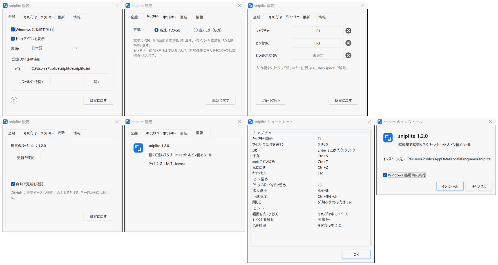

# sniplite

**とても軽くて速い、スクリーンショットとピン留めのツール。コア部分はアセンブリ言語で書かれています**

       

  

[**ダウンロード**](#ダウンロード) | [既定のショートカット](#既定のショートカット) | [よくある質問](#よくある質問)

 
 

## 特長

- **速い**：F1 を押せばすぐキャプチャ。99% のスクリーンショットソフトより速く表示されます
- **軽い**：本体は約 220 KB。ランタイムのインストールは不要で、キャプチャと描画のコア部分はアセンブリ言語です
- **ピン留め**：スクリーンショットを最前面に固定。ほかのウィンドウに切り替えても隠れないので、見比べるのに便利です
- **十分な機能**：キャプチャ、ピン留め、矢印、文字、モザイクがひととおり揃っています
- **クリーン**：広告なし、オープンソース、ログなし、データ収集なし
- **多言語**：8 言語に対応。既定では Windows の言語に従い、自分で選ぶこともできます

## ダウンロード

[Releases](https://github.com/MrTangLuyao/sniplite/releases/latest) から最新版のインストーラーを入手してください。

> [!TIP]
> アイコンはタスクバーの右端にあります。見当たらないときは、そこの小さな矢印をクリックしてください。常に表示するには、Windows の設定で **その他のシステム トレイ アイコン** を検索し、sniplite をオンにします。

## 既定のショートカット

| キー | 動作 |
| --- | --- |
| **F1** | キャプチャ |
| **F3** | コピーした画像や文字を画面にピン留め |
| **Shift+F3** | すべてのピンを隠す / 表示 |
| **Enter** | キャプチャをコピー |
| **Ctrl+S** | キャプチャを保存 |
| **Ctrl+T** | キャプチャを画面にピン留め |
| **Esc** | キャプチャをキャンセル |
| **ホイール** | キャプチャ中は選択するウィンドウの範囲を変更、ピンでは拡大縮小 |
| **ダブルクリック** | ピンを閉じる |

## よくある質問

**サイズはどのくらい？**

とても軽く、1 MB もありません。

**なぜこんなに速いの？**

速さが必要な部分（キャプチャ、画面の合成、描画、キャプチャ画面、ピン留め）は x86-64 アセンブリ言語で、それ以外は C で書かれており、C ランタイムには依存しません。画面を GPU から直接読み取り、合成も GPU 上で Windows に任せるため、Windows で一般的なキャプチャ方法よりずっと高速です。

**メモリはどのくらい使う？**

通常は約 50 MB で、ほとんどはグラフィックドライバーが使う分です。キャプチャ直後は一時的に少し増えます。もっと抑えたい場合は、設定の **キャプチャ** タブで **省メモリ** を選ぶと約 2 MB になりますが、キャプチャは少し遅くなります。

**パソコンに何か残る？**

管理者権限は不要で、レジストリも変更しません。設定を変えると設定ファイルが 1 つ作られ、削除すれば既定に戻ります。

**言語を変えるには？**

既定では Windows の言語に従います。変えるには、トレイアイコンから設定を開き、**言語** で選びます。

**更新するには？**

1 日に 1 回、新しいバージョンがあるか GitHub に確認します。あれば画面右下に通知が出て、クリックするだけで更新できます。確認するのはバージョン番号だけで、データは一切送信しません。設定でオフにもできます。

**アンインストールするには？**

スタートメニューの sniplite フォルダーにある **sniplite のアンインストール** をクリックします。プログラム、設定、ショートカットが削除されます。

**コマンドラインは使える？**

使えます。`sniplite help` で使い方を表示します。

## 設定画面

## 自分でビルドする

[w64devkit](https://github.com/skeeto/w64devkit)（またはほかの MinGW-w64）をインストールし、その `bin` フォルダーを PATH に追加して `build.bat` を実行すると、`build` フォルダーにプログラムができます。ソースは `src` にあります。速さが必要な部分はアセンブリファイル（`.S`）で、gcc が GNU アセンブラーでアセンブルし、それ以外は C ファイル（`.c`）です。C ランタイムはリンクせず、Windows 標準のシステムライブラリだけを使います。

## ライセンス

[MIT](../LICENSE)
