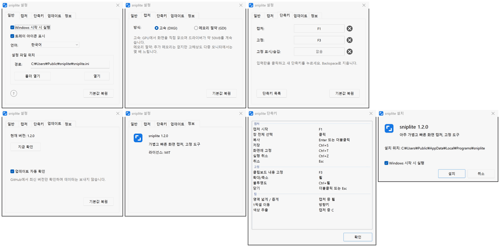

# sniplite

**아주 가볍고 빠른 화면 캡처, 고정 도구. 핵심은 어셈블리로 작성했습니다**

       

  

[**다운로드**](#다운로드) | [기본 단축키](#기본-단축키) | [자주 묻는 질문](#자주-묻는-질문)

 
 
 

 

## 특징

- **빠름**: F1을 누르면 바로 캡처. 스크린샷 프로그램의 99%보다 빨리 화면이 뜹니다
- **가벼움**: 본체 약 360KB, 따로 설치할 런타임이 없고 캡처와 그리기의 핵심 코드는 어셈블리입니다
- **화면 고정**: 스크린샷을 모든 창 위에 고정합니다. 다른 창으로 바꿔도 가려지지 않아 비교하며 보기 좋습니다
- **충분한 기능**: 캡처, 고정, 화살표, 텍스트, 모자이크, 스포트라이트, 돋보기까지 모두 있습니다
- **측정**: 화면 자로 두 점 사이의 거리, 크기, 각도를 측정합니다. Shift로 0°/45°/90°에 맞추고, Alt로 중심에서 측정하며, Enter로 측정값을 복사합니다. 가장자리 자는 화면 위쪽과 왼쪽에 눈금을 항상 표시하고, 가는 십자선이 마우스를 따라가며 멈추면 좌표 상자와 확대경이 표시됩니다
- **텍스트 인식**: 캡처 속의 글자와 표를 읽어 냅니다. 선택해서 설치하는 모듈이며 모두 이 컴퓨터에서 동작합니다
- **스크롤 캡처**: 페이지를 스크롤하면 그 자리에서 이어 붙입니다
- **녹화**: 영역을 선택하고 Ctrl+R을 누르면 포인터와 함께 MP4(H.264, 30fps)로 녹화하고 자동 저장합니다. 바에서 일시 정지할 수 있습니다. 트레이 메뉴나 전역 단축키 Ctrl+Alt+R은 영역을 선택하면 바로 녹화를 시작합니다
- **깔끔함**: 광고 없음, 오픈 소스, 로그 없음, 데이터 수집 없음
- **다국어**: 8개 언어 지원. 기본은 Windows 언어를 따르고 직접 고를 수도 있습니다

## 다운로드

[Releases](https://github.com/MrTangLuyao/sniplite/releases/latest)에서 최신 설치 파일을 받으세요.

설치가 필요 없는 포터블 버전도 두 가지 있습니다. `sniplite_<버전>_portable_x64.exe` 와 텍스트 인식 모듈을 포함한 `sniplite_<버전>_portable_with_OCR_x64.exe` 입니다.

> [!TIP]
> 아이콘은 작업 표시줄 오른쪽 끝에 있습니다. 보이지 않으면 그곳의 작은 화살표를 누르세요. 항상 보이게 하려면 Windows 설정에서 "기타 시스템 트레이 아이콘"을 검색해 sniplite를 켜세요.

## 기본 단축키

| 키 | 동작 |
| --- | --- |
| **F1** | 캡처 |
| **Shift+F1** | 빠른 캡처: 마우스가 있는 화면을 바로 파일로 저장 (저장 위치는 설정에서 지정) |
| **F2** | 색상 추출기: 클릭하여 색상을 복사하고 계속 추출; Shift로 HEX / RGB 전환; Esc 또는 마우스 오른쪽 버튼으로 종료 |
| **R** (색상 추출기 또는 자 안) | 색상 추출기와 화면 자를 전환합니다 |
| **C** (캡처 중) | 커서 아래 색상 복사 |
| **F3** | 복사한 이미지나 텍스트를 화면에 고정 |
| **Shift+F3** | 고정 이미지 모두 숨기기 / 표시 |
| **F4** | 캡처하고 텍스트 인식 (텍스트 인식 모듈 필요) |
| **Shift+F4** | 캡처하고 텍스트 바로 복사 |
| **Enter** | 캡처 복사 |
| **Ctrl+S** | 캡처 저장 |
| **Ctrl+T** | 캡처를 화면에 고정 |
| **가운데 클릭** | 캡처를 화면에 고정 |
| **Ctrl+O** | 선택 영역의 텍스트 인식 |
| **Ctrl+Shift+C** | 선택 영역의 텍스트 바로 복사 |
| **Ctrl+L** | 스크롤 캡처 (스크롤하면 자동으로 이어 붙임) |
| **Ctrl+R** | 선택 영역을 MP4 동영상으로 녹화. 중지 버튼이나 Esc로 종료 |
| **Ctrl+Alt+R** | 녹화 시작: 영역을 선택하면 바로 녹화 (설정 → 단축키에서 변경) |
| **일시 정지 버튼** | 녹화를 일시 정지하거나 다시 시작합니다. 일시 정지한 시간은 영상에 포함되지 않습니다 |
| **Esc** | 캡처 취소 |
| **방향키**, **W A S D** | 커서나 선택 영역을 1픽셀 이동, Shift를 누른 채로는 10픽셀 |
| **휠** | 캡처 중에는 선택할 창 범위 변경, 고정 이미지에서는 확대/축소 |
| **더블클릭** | 고정 이미지 닫기 |

## 자주 묻는 질문

**크기는 얼마나 되나요?**

아주 작습니다. 1MB도 안 됩니다.

**왜 이렇게 빠른가요?**

빨라야 하는 부분(캡처, 화면 합성, 그리기, 선택 화면)은 x86-64 어셈블리로, 나머지는 C로 작성했으며 C 런타임에 의존하지 않습니다. 스크린샷은 그래픽 카드에서 직접 읽어 GPU에서 합성하도록 Windows에 넘기므로, Windows에서 흔히 쓰는 캡처 방식보다 훨씬 빠릅니다.

**다른 프로그램과 비교하면 어떤가요?**

| 프로그램 | 다운로드 | 대기 중 메모리 | 단축키부터 캡처 준비까지 |
| --- | --- | --- | --- |
| **sniplite** | 0.4MB | 11MB | 12ms |
| Snipaste 2.11.3 | 19MB | 50MB | 121ms |
| PixPin 3.6.6 | 66MB | 31MB | 142ms |
| Greenshot 1.3.328 | 4MB | 16MB | 252ms |
| Flameshot 15.0.0 | 18MB | 6MB | 측정 못 함 |
| ShareX 22.4.0 | 139MB | 58MB | 측정 못 함 |

엄밀한 테스트가 아니며 참고용입니다.

**스크린샷의 글자를 꺼내려면?**

영역을 선택하고 텍스트 인식 버튼(Ctrl+O)을 누르면 선택 영역 옆의 패널에 글자가 나타나며, 선택하고 고치고 복사할 수 있습니다. 표는 열을 그대로 유지해서 스프레드시트에 셀로 붙여 넣을 수 있고, Markdown 형식으로 바꿀 수도 있습니다. Ctrl+Shift+C는 글자를 바로 복사합니다. 이 기능에는 텍스트 인식 모듈(12MB, 모델은 PaddleOCR PP-OCRv6, 런타임은 ONNX Runtime이며 모두 이 컴퓨터에서 동작)이 필요합니다. 설정의 OCR 탭에서 설치하거나, 설치 프로그램에서 선택하거나, OCR 포함 포터블 버전을 사용하세요. 설치하기 전에는 텍스트 버튼이 표시되지 않습니다. F4와 Shift+F4는 캡처한 뒤 바로 텍스트를 인식하거나 복사합니다.

**색상을 추출하려면?**

F2(또는 `sniplite pick`)를 누르면 돋보기가 있는 색상 추출기가 화면에 나타납니다. 클릭하여 색상을 복사하고 계속 추출할 수 있습니다. Shift로 `#RRGGBB`와 `R, G, B`를 전환하고 Esc 또는 마우스 오른쪽 버튼으로 닫습니다. 일반 캡처 중 C를 눌러도 커서 아래 색상을 복사할 수 있습니다.

**긴 스크린샷은 어떻게 찍나요?**

영역을 선택하고 스크롤 캡처 버튼(Ctrl+L)을 누른 뒤 페이지를 직접 스크롤하세요. 지나간 내용을 sniplite가 자동으로 이어 붙이고, 옆의 띠에 지금까지의 결과가 보입니다. Enter로 복사하고 Esc로 취소합니다. 저장, 고정, 텍스트 인식도 할 수 있습니다.

**화면을 어떻게 녹화하나요?**

영역을 선택하고 Ctrl+R을 누르면 경과 시간, 일시 정지 버튼, 중지 버튼이 있는 작은 바가 나타납니다. 중지 버튼이나 Esc로 끝내면 MP4가 스크린샷 저장 위치에 저장되고 알림이 표시됩니다. 일시 정지를 누르면(바에 포커스가 있을 때는 Space 키) 잠시 멈출 수 있고, 그동안의 시간은 영상에 포함되지 않습니다. 마우스 포인터도 함께 녹화됩니다. 녹화는 GPU(DXGI 데스크톱 복제와 Media Foundation)를 사용하며 Windows 10/11이 필요합니다. 한 번에 모니터 하나를 녹화하고, 하드웨어 보호가 걸린 콘텐츠(일부 플레이어, DRM 영상)는 검게 나옵니다. 녹화 바 자체는 영상에 포함되지 않습니다.

**캡처는 어디에 저장되나요?**

Ctrl+S로 여는 저장 대화 상자는 마지막으로 저장한 폴더에서 열립니다(처음 저장할 때나 그 폴더가 없어졌을 때는 바꾼 기본 저장 위치에서 열리고, 바꾸지 않았다면 사진 폴더에서 열립니다). 빠른 캡처(Shift+F1)는 기본 저장 위치에 바로 저장됩니다. 기본 저장 위치는 바꾸지 않았다면 바탕 화면이며, 설정의 캡처 탭에서 바꿀 수 있습니다. 거기서 "캡처할 때 파일로도 저장"을 켜면 복사하거나 고정한 캡처도 같은 폴더에 파일로 저장됩니다. 같은 탭의 "파일 이름 형식"에서는 날짜와 시간을 쓰는 몇 가지 형식 가운데 이름 짓는 방식을 고를 수 있습니다.

**게임할 때 단축키가 방해되면 어떻게 하나요?**

설정의 단축키 탭에서 "전체 화면 앱(게임 등)에 단축키 양보"를 켜면, 화면 전체를 쓰는 프로그램이 앞에 있는 동안 sniplite가 단축키를 잠시 해제해 키 입력이 그 프로그램으로 전달됩니다. 다른 창으로 바꾸면 다시 등록합니다. 전체 화면으로 실행되지 않는 프로그램은 "단축키를 양보할 앱"에 추가할 수 있습니다. "관리"를 클릭한 뒤 "새로 만들기"로 파일 이름(예: `game.exe`)을 입력하거나 "찾아보기"로 프로그램을 고르세요.

**메모리는 얼마나 쓰나요?**

평소에는 약 50MB이며 대부분 그래픽 드라이버가 차지합니다. 캡처 직후에는 잠깐 조금 더 씁니다. 더 줄이려면 설정의 캡처 탭에서 메모리 절약을 고르세요. 약 2MB만 쓰지만 캡처가 조금 느려집니다.

**컴퓨터에 무엇이 남나요?**

관리자 권한이 필요 없고 레지스트리를 건드리지 않습니다. 설정을 바꾸거나 저장 대화 상자로 저장하면(폴더를 기억하기 위해) 설정 파일이 하나 생기며, 지우면 기본값으로 돌아갑니다.

**언어는 어떻게 바꾸나요?**

기본은 Windows 언어를 따릅니다. 바꾸려면 트레이 아이콘에서 설정을 열고 언어에서 고르세요.

**업데이트는 어떻게 하나요?**

하루에 한 번 GitHub에 새 버전이 있는지 확인합니다. 있으면 화면 오른쪽 아래에 알림이 뜨고, 한 번 클릭하면 업데이트됩니다. 버전 번호만 확인하며 데이터는 보내지 않습니다. 설정에서 끌 수 있습니다. 포터블 버전은 업데이트를 확인하지 않으니 새 버전은 [Releases](https://github.com/MrTangLuyao/sniplite/releases/latest)에서 받으세요.

**제거는 어떻게 하나요?**

시작 메뉴의 sniplite 폴더에서 "sniplite 제거"를 누르세요. 프로그램, 설정, 바로 가기가 모두 삭제됩니다.

**명령줄에서 쓸 수 있나요?**

네. `sniplite help`를 실행하면 사용법이 나옵니다.

## 설정 화면

## 직접 빌드하기

[w64devkit](https://github.com/skeeto/w64devkit)(또는 다른 MinGW-w64)을 설치하고 `bin` 폴더를 PATH에 추가한 뒤 `build.bat`을 실행하면 `build` 폴더에 프로그램이 만들어집니다. 소스는 `src`에 있습니다. 빨라야 하는 부분은 어셈블리 파일(`.S`)이며 gcc가 GNU 어셈블러로 어셈블하고, 나머지는 C 파일(`.c`)입니다. C 런타임은 링크하지 않고 Windows에 기본으로 들어 있는 시스템 라이브러리만 씁니다.

## 라이선스

[MIT](../LICENSE)

## 서드파티 오픈 소스

sniplite 자체는 Windows에 기본으로 들어 있는 시스템 라이브러리만 씁니다. 선택 사항인 텍스트 인식 모듈은 다른 분들의 작업물이며, 수정 없이 라이선스와 함께 제공합니다(라이선스 또는 그 링크는 모듈의 `ocr` 폴더와 [모듈 릴리스 페이지](https://github.com/MrTangLuyao/sniplite/releases/tag/ocr-2)에 있습니다).

- [ONNX Runtime](https://github.com/microsoft/onnxruntime) 1.26.0, Copyright (c) Microsoft Corporation, MIT 라이선스
- ONNX Runtime에 필요한 [Microsoft Visual C++](https://learn.microsoft.com/cpp/windows/redistributing-visual-cpp-files) 런타임 14.51.36247(`msvcp140.dll`, `msvcp140_1.dll`, `vcruntime140.dll`, `vcruntime140_1.dll`), Copyright (c) Microsoft Corporation, 오픈 소스가 아니며 Microsoft의 [라이선스 조건](https://visualstudio.microsoft.com/license-terms/)에 따라 재배포
- [PaddleOCR](https://github.com/PaddlePaddle/PaddleOCR)의 PP-OCRv6 모델, Copyright (c) PaddlePaddle Authors, Apache License 2.0
- 모델의 ONNX 형식은 [RapidOCR](https://github.com/RapidAI/RapidOCR)에서 제공, Apache License 2.0
