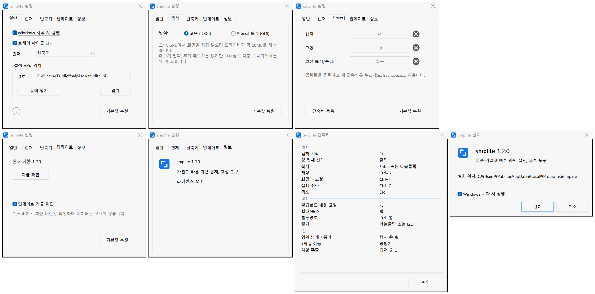

# sniplite

**아주 가볍고 빠른 화면 캡처, 고정 도구. 핵심은 어셈블리로 작성했습니다**

       

  

[**다운로드**](#다운로드) | [기본 단축키](#기본-단축키) | [자주 묻는 질문](#자주-묻는-질문)

 
 

## 특징

- **빠름**: F1을 누르면 바로 캡처. 스크린샷 프로그램의 99%보다 빨리 화면이 뜹니다
- **가벼움**: 본체 약 220KB, 따로 설치할 런타임이 없고 캡처와 그리기의 핵심 코드는 어셈블리입니다
- **화면 고정**: 스크린샷을 모든 창 위에 고정합니다. 다른 창으로 바꿔도 가려지지 않아 비교하며 보기 좋습니다
- **충분한 기능**: 캡처, 고정, 화살표, 텍스트, 모자이크까지 모두 있습니다
- **깔끔함**: 광고 없음, 오픈 소스, 로그 없음, 데이터 수집 없음
- **다국어**: 8개 언어 지원. 기본은 Windows 언어를 따르고 직접 고를 수도 있습니다

## 다운로드

[Releases](https://github.com/MrTangLuyao/sniplite/releases/latest)에서 최신 설치 파일을 받으세요.

> [!TIP]
> 아이콘은 작업 표시줄 오른쪽 끝에 있습니다. 보이지 않으면 그곳의 작은 화살표를 누르세요. 항상 보이게 하려면 Windows 설정에서 "기타 시스템 트레이 아이콘"을 검색해 sniplite를 켜세요.

## 기본 단축키

| 키 | 동작 |
| --- | --- |
| **F1** | 캡처 |
| **F3** | 복사한 이미지나 텍스트를 화면에 고정 |
| **Shift+F3** | 고정 이미지 모두 숨기기 / 표시 |
| **Enter** | 캡처 복사 |
| **Ctrl+S** | 캡처 저장 |
| **Ctrl+T** | 캡처를 화면에 고정 |
| **Esc** | 캡처 취소 |
| **휠** | 캡처 중에는 선택할 창 범위 변경, 고정 이미지에서는 확대/축소 |
| **더블클릭** | 고정 이미지 닫기 |

## 자주 묻는 질문

**크기는 얼마나 되나요?**

아주 작습니다. 1MB도 안 됩니다.

**왜 이렇게 빠른가요?**

빨라야 하는 부분(캡처, 화면 합성, 그리기, 선택 화면)은 x86-64 어셈블리로, 나머지는 C로 작성했으며 C 런타임에 의존하지 않습니다. 스크린샷은 그래픽 카드에서 직접 읽어 GPU에서 합성하도록 Windows에 넘기므로, Windows에서 흔히 쓰는 캡처 방식보다 훨씬 빠릅니다.

**메모리는 얼마나 쓰나요?**

평소에는 약 50MB이며 대부분 그래픽 드라이버가 차지합니다. 캡처 직후에는 잠깐 조금 더 씁니다. 더 줄이려면 설정의 캡처 탭에서 메모리 절약을 고르세요. 약 2MB만 쓰지만 캡처가 조금 느려집니다.

**컴퓨터에 무엇이 남나요?**

관리자 권한이 필요 없고 레지스트리를 건드리지 않습니다. 설정을 바꾸면 설정 파일이 하나 생기며, 지우면 기본값으로 돌아갑니다.

**언어는 어떻게 바꾸나요?**

기본은 Windows 언어를 따릅니다. 바꾸려면 트레이 아이콘에서 설정을 열고 언어에서 고르세요.

**업데이트는 어떻게 하나요?**

하루에 한 번 GitHub에 새 버전이 있는지 확인합니다. 있으면 화면 오른쪽 아래에 알림이 뜨고, 한 번 클릭하면 업데이트됩니다. 버전 번호만 확인하며 데이터는 보내지 않습니다. 설정에서 끌 수 있습니다.

**제거는 어떻게 하나요?**

시작 메뉴의 sniplite 폴더에서 "sniplite 제거"를 누르세요. 프로그램, 설정, 바로 가기가 모두 삭제됩니다.

**명령줄에서 쓸 수 있나요?**

네. `sniplite help`를 실행하면 사용법이 나옵니다.

## 설정 화면

## 직접 빌드하기

[w64devkit](https://github.com/skeeto/w64devkit)(또는 다른 MinGW-w64)을 설치하고 `bin` 폴더를 PATH에 추가한 뒤 `build.bat`을 실행하면 `build` 폴더에 프로그램이 만들어집니다. 소스는 `src`에 있습니다. 빨라야 하는 부분은 어셈블리 파일(`.S`)이며 gcc가 GNU 어셈블러로 어셈블하고, 나머지는 C 파일(`.c`)입니다. C 런타임은 링크하지 않고 Windows에 기본으로 들어 있는 시스템 라이브러리만 씁니다.

## 라이선스

[MIT](../LICENSE)
