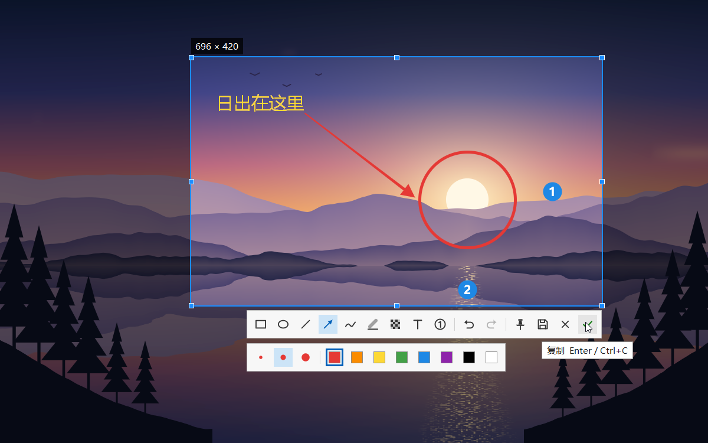
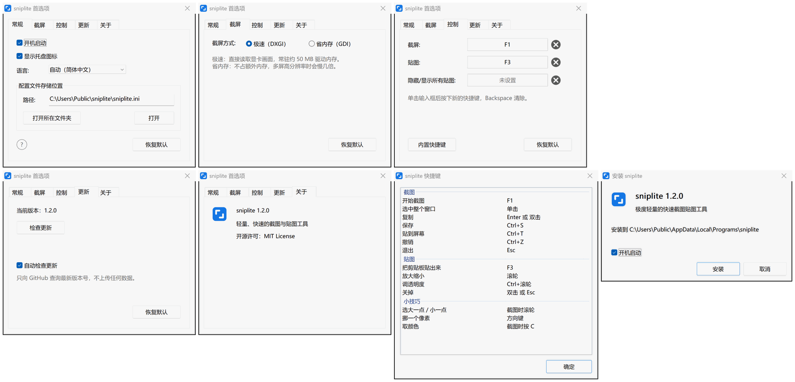

# sniplite

**极度轻量的截图贴图工具，核心用汇编开发**

       

  

[**下载**](#下载) · [默认快捷键](#默认快捷键) · [常见问题](#常见问题)

 
 
 

 

## 特色

- **快**：按F1截图 领先99%截图软件的截图速度
- **轻**：本体约280KB，无需安装任何运行库，截图和绘图的核心代码用汇编编写
- **能贴图**：把截图钉在屏幕最上层，切到别的窗口也挡不住，对照着看很方便
- **够用**：功能全面，截图，贴图，箭头，文字，马赛克 样样都有
- **能识字**：截图里的文字和表格都能识别出来，模块可选，全部在本机完成
- **长截图**：自己滚动页面，边滚边自动拼接
- **干净**：没有广告，开源，无日志，不收集数据
- **多语言**：内置 8 种语言，默认跟随系统，也可以自己选

## 下载

到 [Releases](https://github.com/MrTangLuyao/sniplite/releases/latest) 下载最新版安装。

也有两个免安装的便携版：`sniplite_<版本>_portable_x64.exe`，以及自带文字识别模块的 `sniplite_<版本>_portable_with_OCR_x64.exe`。

**macOS**：适用于 macOS 14 及以上（Apple 芯片和 Intel）的原生版在 [`macos`](../macos/README.zh-CN.md) 文件夹。用 `macos/build.sh` 编译，把 `sniplite.app` 复制到"应用程序"，因为没有公证，需要先运行一次 `xattr -dr com.apple.quarantine "/Applications/sniplite.app"`。

> [!TIP]
> 图标在任务栏右下角，没看到的话点一下那里的小箭头。想让它一直显示，在 Windows 设置里搜索“其他系统托盘图标”，把 sniplite 打开。

## 默认快捷键

| 按键 | 作用 |
| --- | --- |
| **F1** | 截图 |
| **F3** | 把复制的图片或文字贴到屏幕上 |
| **Shift+F3** | 隐藏 / 显示所有贴图 |
| **F4** | 截图并识别文字（需要文字识别模块） |
| **Shift+F4** | 截图并直接复制文字 |
| **Enter** | 复制截图 |
| **Ctrl+S** | 保存截图 |
| **Ctrl+T** | 把截图贴到屏幕上 |
| **鼠标中键** | 把截图贴到屏幕上 |
| **Ctrl+O** | 识别选区里的文字 |
| **Ctrl+Shift+C** | 直接复制选区里的文字 |
| **Ctrl+L** | 长截图，滚动页面自动拼接 |
| **Esc** | 取消截图 |
| **方向键**、**W A S D** | 把鼠标或选区挪一个像素，同时按住 Shift 挪十个 |
| **滚轮** | 截图时换窗口范围，贴图时缩放 |
| **双击** | 关闭贴图 |

## 常见问题

**软件有多大？**

极其轻量，不到 1 MB。

**为什么这么快？**

截图、画面合成、绘制和截图界面这些要快的部分用 x86-64 汇编编写，其余部分用 C，整个程序不依赖 C 运行库。截图直接从显卡读取屏幕画面，交给系统在显卡上合成显示，比 Windows 常用的截屏方法快很多。

**和其他截图软件比怎么样？**

| 软件 | 下载大小 | 空闲时内存 | 按下热键到可以截图 |
| --- | --- | --- | --- |
| **sniplite** | 0.4 MB | 11 MB | 12 毫秒 |
| Snipaste 2.11.3 | 19 MB | 50 MB | 121 毫秒 |
| PixPin 3.6.6 | 66 MB | 31 MB | 142 毫秒 |
| Greenshot 1.3.328 | 4 MB | 16 MB | 252 毫秒 |
| Flameshot 15.0.0 | 18 MB | 6 MB | 没测成 |
| ShareX 22.4.0 | 139 MB | 58 MB | 没测成 |

这是一次不严谨的测试，仅供参考。

**怎么把截图里的文字提取出来？**

框选一块区域，点识别文字按钮（Ctrl+O），文字会出现在选区旁边的面板里，可以选中、修改和复制。表格会保持分列，粘贴到 Excel 里直接分格，也可以切换成 Markdown 格式。Ctrl+Shift+C 可以直接复制文字。这需要文字识别模块（12 MB，模型是 PaddleOCR PP-OCRv6，运行库是 ONNX Runtime，全部在本机运行）：可以在首选项的文字识别页安装，安装时勾选，或者直接用带 OCR 的便携版。没装模块时不显示文字按钮。按 F4 或 Shift+F4 可以直接开始截图并识别或复制文字。

**怎么截长图？**

框选区域，点长截图按钮（Ctrl+L），然后自己滚动页面。sniplite 会把滚过的内容自动拼起来，旁边的预览条显示已经拼好的部分。按 Enter 复制，按 Esc 取消，也可以保存、贴图或者识别其中的文字。

**占多少内存？**

平时大约 50 MB，主要是显卡驱动占的，刚截完图会短暂多占一些。想更省的话，可以在首选项的截屏页里选省内存，只占 2 MB 左右，代价是截图会慢一点。

**会在电脑上留下什么？**

不用管理员权限，不改注册表。改过设置后会多一个设置文件，删掉它就恢复默认。

**怎么换语言？**

默认跟随 Windows 的语言。想换的话，从托盘图标打开首选项，在语言一栏里选。

**怎么更新？**

软件每天会到 GitHub 看一眼有没有新版本，有的话右下角会提示，点一下就能更新。只查版本号，不上传任何数据，不想要可以在首选项里关掉。

**怎么卸载？**

在开始菜单的 sniplite 文件夹里点“卸载 sniplite”，程序、设置和快捷方式都会删掉。

**能用命令行吗？**

能，运行 sniplite help 就能看到用法。

## 首选项

## 自己编译

装好 [w64devkit](https://github.com/skeeto/w64devkit)（或其他 MinGW-w64），把它的 `bin` 文件夹加进 PATH，然后运行 `build.bat`，程序会生成在 `build` 文件夹里。源码在 `src` 里：要快的部分是汇编文件（`.S`），由 gcc 调用 GNU 汇编器编译，其余是 C 文件（`.c`）。不链接 C 运行库，只用到 Windows 自带的系统库。

macOS 版用 `macos/build.sh` 编译，只需要 Xcode 命令行工具，详见 [`macos`](../macos/README.zh-CN.md)。

## 许可证

[MIT](../LICENSE)

## 第三方开源组件

sniplite 本身只用到 Windows 自带的系统库。可选的文字识别模块是别人的成果，原样提供，并附带它们的许可证（在模块的 `ocr` 文件夹里，也在[模块的发布页](https://github.com/MrTangLuyao/sniplite/releases/tag/ocr-1)）：

- [ONNX Runtime](https://github.com/microsoft/onnxruntime) 1.26.0，Copyright (c) Microsoft Corporation，MIT 许可证
- [PaddleOCR](https://github.com/PaddlePaddle/PaddleOCR) 的 PP-OCRv6 模型，Copyright (c) PaddlePaddle Authors，Apache 2.0 许可证
- 模型的 ONNX 格式来自 [RapidOCR](https://github.com/RapidAI/RapidOCR)，Apache 2.0 许可证
