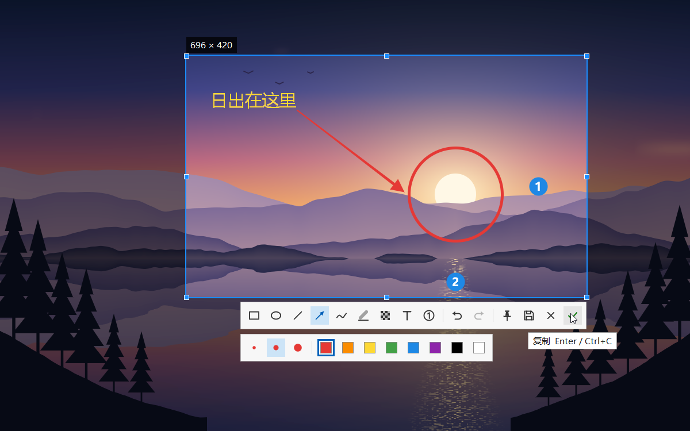
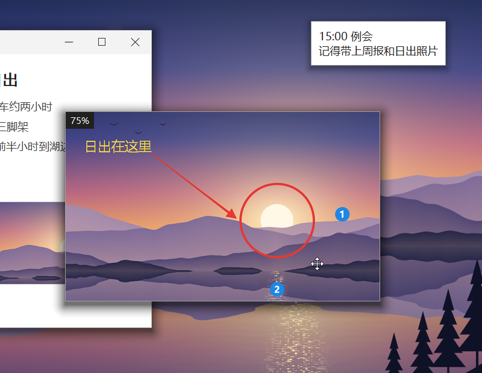
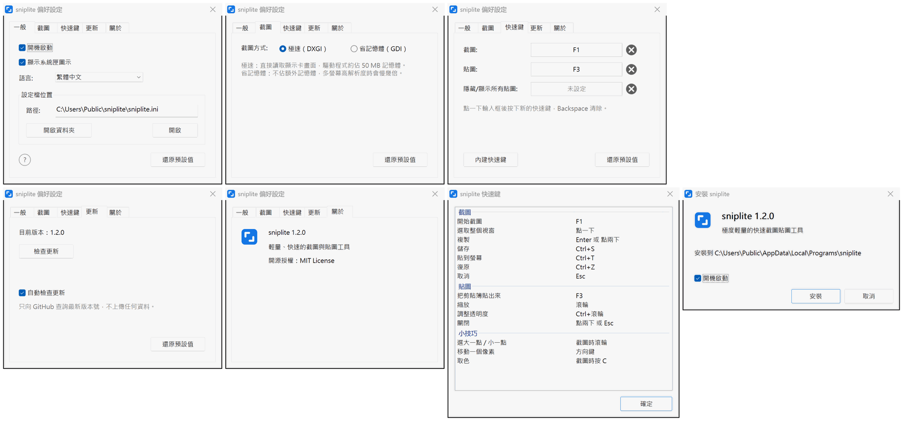

# sniplite

**極度輕量的截圖貼圖工具，核心用組合語言開發**

       

  

[**下載**](#下載) | [預設快速鍵](#預設快速鍵) | [常見問題](#常見問題)

 
 
 

 

## 特色

- **快**：按 F1 截圖，速度領先 99% 的截圖軟體
- **輕**：本體約 320 KB，不用安裝任何執行環境，截圖和繪圖的核心程式碼用組合語言撰寫
- **能貼圖**：把截圖釘在螢幕最上層，切到別的視窗也擋不住，對照著看很方便
- **夠用**：功能齊全，截圖、貼圖、箭頭、文字、馬賽克、聚光燈、放大鏡樣樣都有
- **能量尺寸**：螢幕標尺拖兩點就能量出距離、尺寸和角度；按住 Shift 吸附 0°/45°/90°，按住 Alt 從中心量，Enter 複製讀數；邊緣刻度尺可以常駐螢幕頂端和左側，細十字準線會跟隨滑鼠，滑鼠停下時顯示座標框
- **能辨識文字**：截圖裡的文字和表格都能辨識出來，模組可選，全部在本機完成
- **長截圖**：自己捲動頁面，邊捲邊自動拼接
- **乾淨**：沒有廣告，開源，無記錄檔，不收集資料
- **多語言**：內建 8 種語言，預設跟隨系統，也可以自己選

## 下載

到 [Releases](https://github.com/MrTangLuyao/sniplite/releases/latest) 下載最新版安裝。

也有兩個免安裝版：`sniplite_<版本>_portable_x64.exe`，以及內含文字辨識模組的 `sniplite_<版本>_portable_with_OCR_x64.exe`。

> [!TIP]
> 圖示在工作列右下角，沒看到的話點一下那裡的小箭頭。想讓它一直顯示，在 Windows 設定裡搜尋“其他系統匣圖示”，把 sniplite 打開。

## 預設快速鍵

| 按鍵 | 功能 |
| --- | --- |
| **F1** | 截圖 |
| **Shift+F1** | 快速截圖：滑鼠所在的螢幕直接存成檔案（儲存位置在偏好設定裡設定） |
| **F2** | 取色器：單擊複製顏色並繼續取色；Shift 切換 HEX / RGB；Esc 或右鍵退出 |
| **R**（取色器或標尺裡） | 在取色器和螢幕標尺之間切換 |
| **C**（截圖時） | 複製游標下的顏色 |
| **F3** | 把複製的圖片或文字貼到螢幕上 |
| **Shift+F3** | 隱藏 / 顯示所有貼圖 |
| **F4** | 截圖並辨識文字（需要文字辨識模組） |
| **Shift+F4** | 截圖並直接複製文字 |
| **Enter** | 複製截圖 |
| **Ctrl+S** | 儲存截圖 |
| **Ctrl+T** | 把截圖貼到螢幕上 |
| **滑鼠中鍵** | 把截圖貼到螢幕上 |
| **Ctrl+O** | 辨識選取範圍裡的文字 |
| **Ctrl+Shift+C** | 直接複製選取範圍裡的文字 |
| **Ctrl+L** | 長截圖，捲動頁面自動拼接 |
| **Esc** | 取消截圖 |
| **方向鍵**、**W A S D** | 把滑鼠或選取範圍移動一個像素，同時按住 Shift 移動十個 |
| **滾輪** | 截圖時換視窗範圍，貼圖時縮放 |
| **點兩下** | 關閉貼圖 |

## 常見問題

**軟體有多大？**

極其輕量，不到 1 MB。

**為什麼這麼快？**

截圖、畫面合成、繪製和截圖介面這些要快的部分用 x86-64 組合語言撰寫，其餘部分用 C，整個程式不依賴 C 執行階段程式庫。截圖直接從顯示卡讀取螢幕畫面，交給系統在顯示卡上合成顯示，比 Windows 常用的截圖方法快很多。

**和其他截圖軟體比怎麼樣？**

| 軟體 | 下載大小 | 閒置時記憶體 | 按下快速鍵到可以截圖 |
| --- | --- | --- | --- |
| **sniplite** | 0.4 MB | 11 MB | 12 毫秒 |
| Snipaste 2.11.3 | 19 MB | 50 MB | 121 毫秒 |
| PixPin 3.6.6 | 66 MB | 31 MB | 142 毫秒 |
| Greenshot 1.3.328 | 4 MB | 16 MB | 252 毫秒 |
| Flameshot 15.0.0 | 18 MB | 6 MB | 沒測成 |
| ShareX 22.4.0 | 139 MB | 58 MB | 沒測成 |

這是一次不嚴謹的測試，僅供參考。

**怎麼把截圖裡的文字取出來？**

框選一塊區域，按辨識文字按鈕（Ctrl+O），文字會出現在選取範圍旁邊的面板裡，可以選取、修改和複製。表格會保持分欄，貼到 Excel 裡直接分格，也可以切換成 Markdown 格式。Ctrl+Shift+C 可以直接複製文字。這需要文字辨識模組（12 MB，模型是 PaddleOCR PP-OCRv6，執行庫是 ONNX Runtime，全部在本機執行）：可以在偏好設定的文字辨識分頁安裝，安裝時勾選，或者直接用帶 OCR 的免安裝版。沒裝模組時不顯示文字按鈕。按 F4 或 Shift+F4 可以直接開始截圖並辨識或複製文字。

**怎麼取色？**

按 F2（或執行 `sniplite pick`），螢幕上會出現帶放大鏡的取色器。單擊複製顏色並繼續取色；Shift 在 `#RRGGBB` 和 `R, G, B` 之間切換；Esc 或右鍵退出。普通截圖時按 C 也能複製游標下的顏色。

**怎麼量螢幕上的尺寸？**

點托盤圖示選「螢幕標尺」，或者執行 `sniplite ruler`。從一個點拖到另一個點，讀數會顯示寬 × 高、像素距離和角度。按住 Shift 吸附到 0°/45°/90°，按住 Alt 以按下的位置為中心向兩邊量；方向鍵微調終點一個像素，同時按住 Shift 微調十個。按 Enter 或 C 複製讀數，按 R 切換到取色器，Esc 退出。想讓刻度一直留在螢幕上，執行 `sniplite ruler --edge`（或點托盤選單裡的「邊緣刻度尺」）：滑鼠所在螢幕的頂端和左側會出現刻度，依該螢幕的 DPI 縮放；它不會搶焦點、不擋滑鼠，也不會進入截圖。細十字準線會跟著滑鼠，滑鼠離開這塊螢幕時自動收起；滑鼠停下後，旁邊的小框會顯示目前像素座標，下方彈出帶網格和中心像素標記的像素放大鏡。十字準線可以在托盤選單裡單獨開關。準線和座標框的顏色可以在 `sniplite.ini` 的 `[sniplite]` 段裡用 `cross_color=RRGGBB` 設定（預設 `00D6F5`），重新啟動 sniplite 後生效。執行 `sniplite ruler --edge --hide`（或選「隱藏邊緣刻度尺」）就能關閉。

**怎麼截長圖？**

框選區域，按長截圖按鈕（Ctrl+L），然後自己捲動頁面。sniplite 會把捲過的內容自動拼起來，旁邊的預覽條顯示已經拼好的部分。按 Enter 複製，按 Esc 取消，也可以儲存、貼圖或辨識其中的文字。

**截圖存在哪裡？**

按 Ctrl+S 時，儲存對話方塊會開在上次儲存的資料夾；第一次儲存，或那個資料夾不在了，就開在你改過的預設儲存位置，沒改過就開在“圖片”資料夾。快速截圖（Shift+F1）直接存到預設儲存位置，沒改過就是桌面，可以在偏好設定的“截圖”分頁變更。在那裡勾選“截圖時同時儲存檔案”，複製或貼圖的截圖也會同時存一份到這個資料夾。同一分頁的“檔案名稱格式”可以選檔案怎麼命名，有幾種日期時間格式。

**快速鍵和遊戲衝突怎麼辦？**

在偏好設定的“快速鍵”分頁勾選“全螢幕程式（如遊戲）在前景時讓出快速鍵”後，只要佔滿螢幕的程式在前景，sniplite 就會暫時放開快速鍵，按鍵直接交給那個程式，切走後再拿回來。不是全螢幕執行的程式，可以加到“讓出快速鍵的程式”裡：點“管理”，用“新增”填程式的檔名（例如 `game.exe`），或用“瀏覽”直接選取程式。

**佔多少記憶體？**

平時大約 50 MB，主要是顯示卡驅動程式佔的，剛截完圖會短暫多佔一些。想更省的話，可以在偏好設定的“截圖”分頁選“省記憶體”，只佔 2 MB 左右，代價是截圖會慢一點。

**會在電腦上留下什麼？**

不需要系統管理員權限，不改登錄檔。改過設定，或用儲存對話方塊存過檔案（它會記住資料夾）後，會多一個設定檔，刪掉它就還原預設值。

**怎麼換語言？**

預設跟隨 Windows 的語言。想換的話，從系統匣圖示開啟偏好設定，在語言一欄選擇。

**怎麼更新？**

軟體每天會到 GitHub 看一眼有沒有新版本，有的話右下角會提示，點一下就能更新。只查版本號，不上傳任何資料，不想要可以在偏好設定裡關掉。免安裝版不檢查更新，需要新版本時到 [Releases](https://github.com/MrTangLuyao/sniplite/releases/latest) 重新下載。

**怎麼解除安裝？**

在開始功能表的 sniplite 資料夾裡點“解除安裝 sniplite”，程式、設定和捷徑都會刪掉。

**能用命令列嗎？**

能，執行 `sniplite help` 就能看到用法。

## 偏好設定

## 自己編譯

裝好 [w64devkit](https://github.com/skeeto/w64devkit)（或其他 MinGW-w64），把它的 `bin` 資料夾加進 PATH，然後執行 `build.bat`，程式會產生在 `build` 資料夾裡。原始碼在 `src` 裡：要快的部分是組合語言檔案（`.S`），由 gcc 呼叫 GNU 組譯器組譯，其餘是 C 檔案（`.c`）。不連結 C 執行階段程式庫，只用到 Windows 內建的系統程式庫。

## 授權

[MIT](../LICENSE)

## 第三方開源元件

sniplite 本身只用到 Windows 內建的系統程式庫。選用的文字辨識模組是他人的成果，原樣提供，並附帶它們的授權條款或其連結（在模組的 `ocr` 資料夾裡，也在[模組的發布頁](https://github.com/MrTangLuyao/sniplite/releases/tag/ocr-2)）：

- [ONNX Runtime](https://github.com/microsoft/onnxruntime) 1.26.0，Copyright (c) Microsoft Corporation，MIT 授權
- ONNX Runtime 需要的 [Microsoft Visual C++](https://learn.microsoft.com/cpp/windows/redistributing-visual-cpp-files) 執行階段程式庫 14.51.36247（`msvcp140.dll`、`msvcp140_1.dll`、`vcruntime140.dll`、`vcruntime140_1.dll`），Copyright (c) Microsoft Corporation，不是開源軟體，依 Microsoft 的[授權條款](https://visualstudio.microsoft.com/license-terms/)轉散發
- [PaddleOCR](https://github.com/PaddlePaddle/PaddleOCR) 的 PP-OCRv6 模型，Copyright (c) PaddlePaddle Authors，Apache 2.0 授權
- 模型的 ONNX 格式來自 [RapidOCR](https://github.com/RapidAI/RapidOCR)，Apache 2.0 授權
