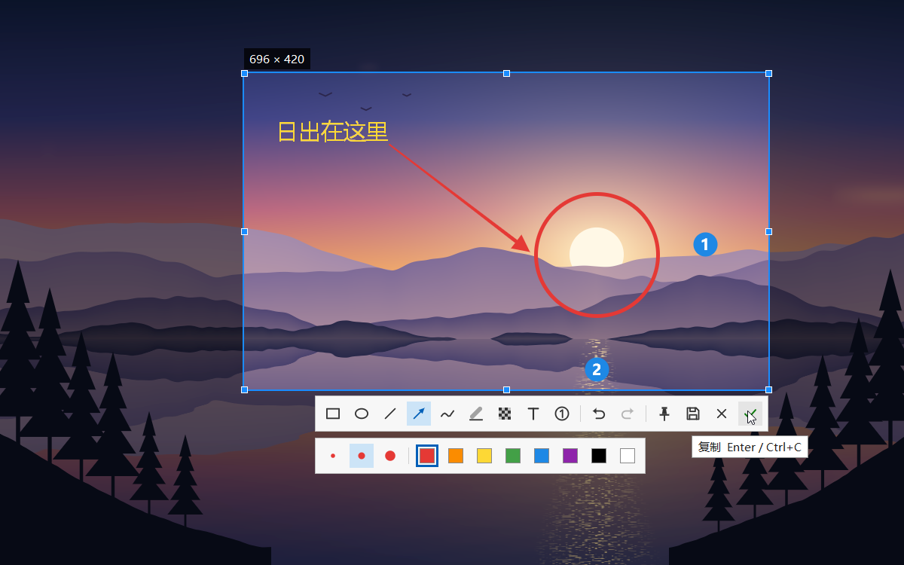
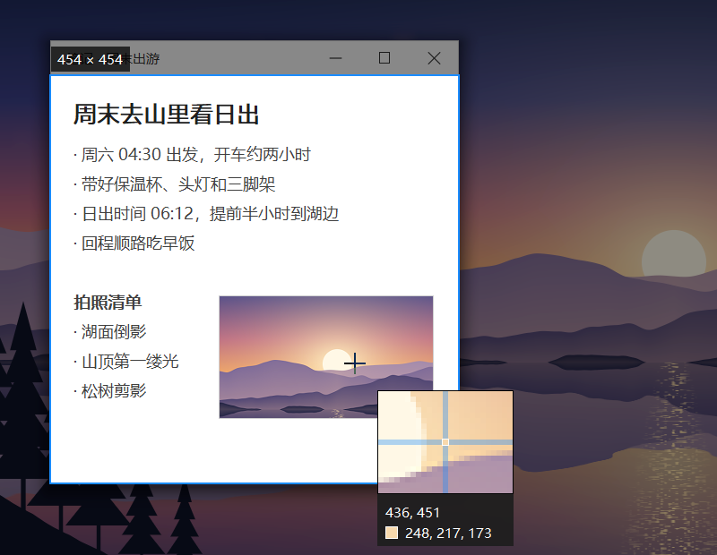
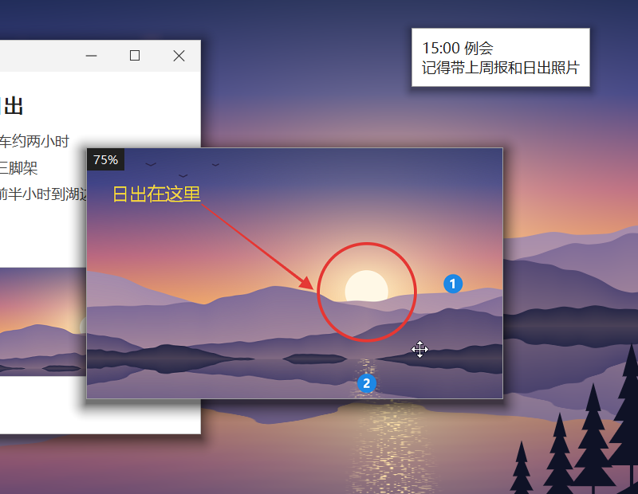
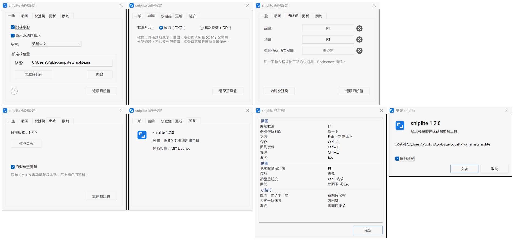

# sniplite

**極度輕量的截圖貼圖工具，核心用組合語言開發**

       

  

[**下載**](#下載) | [預設快速鍵](#預設快速鍵) | [常見問題](#常見問題)

 
 

## 特色

- **快**：按 F1 截圖，速度領先 99% 的截圖軟體
- **輕**：本體約 220 KB，不用安裝任何執行環境，截圖和繪圖的核心程式碼用組合語言撰寫
- **能貼圖**：把截圖釘在螢幕最上層，切到別的視窗也擋不住，對照著看很方便
- **夠用**：功能齊全，截圖、貼圖、箭頭、文字、馬賽克樣樣都有
- **乾淨**：沒有廣告，開源，無記錄檔，不收集資料
- **多語言**：內建 8 種語言，預設跟隨系統，也可以自己選

## 下載

到 [Releases](https://github.com/MrTangLuyao/sniplite/releases/latest) 下載最新版安裝。

> [!TIP]
> 圖示在工作列右下角，沒看到的話點一下那裡的小箭頭。想讓它一直顯示，在 Windows 設定裡搜尋“其他系統匣圖示”，把 sniplite 打開。

## 預設快速鍵

| 按鍵 | 功能 |
| --- | --- |
| **F1** | 截圖 |
| **F3** | 把複製的圖片或文字貼到螢幕上 |
| **Shift+F3** | 隱藏 / 顯示所有貼圖 |
| **Enter** | 複製截圖 |
| **Ctrl+S** | 儲存截圖 |
| **Ctrl+T** | 把截圖貼到螢幕上 |
| **Esc** | 取消截圖 |
| **滾輪** | 截圖時換視窗範圍，貼圖時縮放 |
| **點兩下** | 關閉貼圖 |

## 常見問題

**軟體有多大？**

極其輕量，不到 1 MB。

**為什麼這麼快？**

截圖、畫面合成、繪製和截圖介面這些要快的部分用 x86-64 組合語言撰寫，其餘部分用 C，整個程式不依賴 C 執行階段程式庫。截圖直接從顯示卡讀取螢幕畫面，交給系統在顯示卡上合成顯示，比 Windows 常用的截圖方法快很多。

**和其他截圖軟體比怎麼樣？**

| 軟體 | 下載大小 | 閒置時記憶體 | 按下快速鍵到可以截圖 |
| --- | --- | --- | --- |
| **sniplite** | 0.3 MB | 11 MB | 12 毫秒 |
| Snipaste 2.11.3 | 19 MB | 50 MB | 121 毫秒 |
| PixPin 3.6.6 | 66 MB | 31 MB | 142 毫秒 |
| Greenshot 1.3.328 | 4 MB | 16 MB | 252 毫秒 |
| Flameshot 15.0.0 | 18 MB | 6 MB | 沒測成 |
| ShareX 22.4.0 | 139 MB | 58 MB | 沒測成 |

這是一次不嚴謹的測試，僅供參考。

**佔多少記憶體？**

平時大約 50 MB，主要是顯示卡驅動程式佔的，剛截完圖會短暫多佔一些。想更省的話，可以在偏好設定的“截圖”分頁選“省記憶體”，只佔 2 MB 左右，代價是截圖會慢一點。

**會在電腦上留下什麼？**

不需要系統管理員權限，不改登錄檔。改過設定後會多一個設定檔，刪掉它就還原預設值。

**怎麼換語言？**

預設跟隨 Windows 的語言。想換的話，從系統匣圖示開啟偏好設定，在語言一欄選擇。

**怎麼更新？**

軟體每天會到 GitHub 看一眼有沒有新版本，有的話右下角會提示，點一下就能更新。只查版本號，不上傳任何資料，不想要可以在偏好設定裡關掉。

**怎麼解除安裝？**

在開始功能表的 sniplite 資料夾裡點“解除安裝 sniplite”，程式、設定和捷徑都會刪掉。

**能用命令列嗎？**

能，執行 `sniplite help` 就能看到用法。

## 偏好設定

## 自己編譯

裝好 [w64devkit](https://github.com/skeeto/w64devkit)（或其他 MinGW-w64），把它的 `bin` 資料夾加進 PATH，然後執行 `build.bat`，程式會產生在 `build` 資料夾裡。原始碼在 `src` 裡：要快的部分是組合語言檔案（`.S`），由 gcc 呼叫 GNU 組譯器組譯，其餘是 C 檔案（`.c`）。不連結 C 執行階段程式庫，只用到 Windows 內建的系統程式庫。

## 授權

[MIT](../LICENSE)
